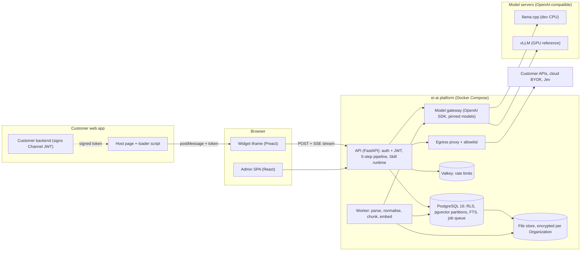
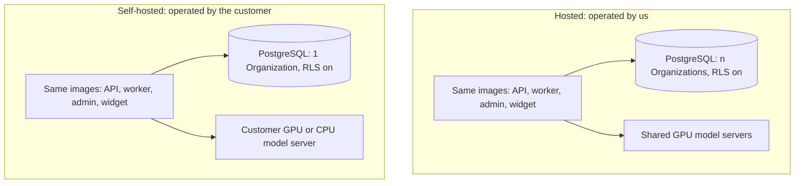

# ADR-001: Tech stack and overall architecture

- Status: Proposed
- Date: 2026-10-13
- Deciders: Hao (Howie) C. NGUYEN (PO/Tech Lead), AI agent team
- Ticket: EA-11 (SET-01)

## 1. Context

ei-ai is an embeddable enterprise AI assistant: a widget in an iframe inside a customer's web apps, an admin web app, and a backend that answers from permissioned documents, returns approved scripts verbatim and reads live app data through Skills. One multi-tenant codebase serves both the hosted product and the self-hosted install (D1, D6). Models run locally by default (D17, D18). The prototype is built by one human reviewer (the owner, PO and Tech Lead) and AI coding agents (Claude Code agent team); it targets about ten two-week sprints and has no hard deadline (backlog Q1, Q3).

This ADR fixes the stack and the overall architecture before milestone M0, so that SET-03 (repo skeleton, CI), FND-01 (data model and RLS) and FND-07 (model gateway) can start without changing foundations later. It is also the answer to backlog Q1 to Q3 and to the open question of EA-24 ("can Ollama pin by digest, else llama.cpp plus a checksummed GGUF").

Constraints that drive the decisions:

- The 15 foundations F1 to F15 (`docs/workshop/tong-hop.md` section 5) cannot be added later without rework. Tenant isolation (D46) must be decided before the first line of code.
- Everything must run on the dev machine: Windows 11, Ryzen 5 5600G, 16 GB RAM, no GPU (NFR of EA-11). A rented GPU is used only to measure quality and latency (SET-04, R2, R8).
- The product is built on open-source libraries with our own core (D64). Licences must allow hosted use and distribution of self-hosted container images. The binding approved list is [oss-license-review.md](oss-license-review.md) (SET-02, EA-12); this ADR records the licence of every option and the red flags it found.
- UI first (D65): the stack must implement the design in DSN-01 (EA-85).

Scope limits: this ADR does not define the data model (FND-01), the encryption implementation (FND-03), the model catalog (FND-07) or the egress proxy implementation (FND-10). It decides which mechanism each of them uses.

## 2. Selection criteria

| ID | Criterion | Weight | Source |
|---|---|---|---|
| C1 | Fits the hard constraints F1 to F15 (tenant isolation, per-Organization vector index and keys, pinned models, masked logs, egress control) | Must | tong-hop section 5, D46 |
| C2 | Licence allows hosted use and distribution of self-hosted container images; no AGPL, SSPL, RSAL or BUSL in shipped components | Must | EA-11 NFR, D64, EA-12 |
| C3 | Runs in 16 GB RAM on CPU for development | Must | EA-11 NFR, D4 |
| C4 | Mainstream, typed, easy to test and friendly to AI coding agents (one human reviewer) | High | backlog Q1 |
| C5 | RAG, ML and Vietnamese NLP ecosystem | High | D60, tong-hop section 10 (O3) |
| C6 | Fewest moving parts (components to run, secure and upgrade) | High | self-hosted install, one reviewer |
| C7 | Same codebase and images for hosted and self-hosted (no fork, no mode that weakens isolation) | Must | D1, D6 |
| C8 | Performance headroom for the D57 targets on the reference GPU configuration | Medium | D57, D4 |

## 3. Decisions per component

Option tables show the licence (verified against the project's licence file or registry entry, URLs in section 12; the remaining licences were confirmed by SET-02 in [oss-license-review.md](oss-license-review.md)), the fit to the criteria above and notes.

### 3.1 Backend language and framework

| Option | Licence | Fit to criteria | Notes |
|---|---|---|---|
| Python 3.12 + FastAPI (Pydantic v2, uvicorn, httpx) | FastAPI MIT, Pydantic MIT, uvicorn BSD-3-Clause, httpx BSD-3-Clause | C4, C5 strong; C1, C7 neutral; C8 adequate (I/O bound, models are remote processes) | Best RAG, ML and Vietnamese NLP ecosystem; typed with mypy strict and Pydantic; async streaming (SSE) is first class |
| TypeScript + NestJS | NestJS MIT | C4 good; C5 weaker for NLP and ingestion (parsing, normalisation, evaluation harness) | One language across backend and frontend, but the AI and eval tooling would still need Python services |
| Go | Go BSD-3-Clause | C8 strong, C3 good; C4 and C5 weaker (fewer RAG and NLP libraries, more boilerplate for agents to get right) | Fast and small binaries, but the ecosystem for ingestion and evaluation is thin |

**Choice:** Python 3.12 with FastAPI.

**Reasons:**
- Backlog Q2 default and the owner's language preference; the largest RAG, document-parsing and evaluation ecosystem, which dominates the work in epics E2, E4 and E8 (C5).
- Typed (mypy strict, Pydantic v2) and easy to test with pytest, which suits a single human reviewer plus AI agents (C4).
- The workload is I/O bound (database, model server over HTTP, streaming), so Go's speed advantage buys little (C8).
- Tooling: ruff (lint and format), mypy (type check), pytest with pytest-asyncio. The same choice covers the ingestion worker (one language, shared models and tenant helpers).

### 3.2 Database and tenant isolation

| Option | Licence | Fit to criteria | Notes |
|---|---|---|---|
| PostgreSQL 16 with row-level security (FORCE, non-owner app role, transaction-local tenant setting, composite foreign keys), SQLAlchemy 2 + Alembic | PostgreSQL Licence; SQLAlchemy MIT; Alembic MIT; psycopg 3 driver LGPL-3.0-only (see section 10) | C1 strong (D46 layer 2 enforced by the database); C6 strong (also hosts vectors, keyword search, jobs); C7 | Proven by the PoC (section 9). Views, SECURITY DEFINER functions and side paths need discipline (rules in section 9) |
| MySQL or MariaDB | MariaDB server GPL-2.0; MySQL Community Server GPL-2.0 with additional linking permissions | C1 weak: no native row-level security, so isolation depends on every query | Would need a separate vector store and search engine (C6) |
| Database per tenant | PostgreSQL Licence | C1 strongest isolation; C6 weak (provisioning, migrations and connection pools per tenant) | Rejected for the prototype by D46 (shared database with `org_id` and RLS); remains a possible tier for large self-hosted customers |

**Choice:** PostgreSQL 16 with row-level security, accessed through SQLAlchemy 2 (async, psycopg 3 driver) and migrated with Alembic.

**Reasons:**
- D46 requires `org_id` on every table plus database-enforced row isolation; PostgreSQL provides it natively and the PoC proves it (C1).
- One engine also serves vectors, keyword search, the job queue and the append-only trace, usage and audit tables, so there are fewer components (C6) and the same isolation applies to all of them.
- Pitfalls are known and testable: table owners and BYPASSRLS roles skip policies, and referential-integrity checks bypass row security (PostgreSQL docs), hence FORCE RLS, a non-owner application role and composite foreign keys (section 9).
- PostgreSQL 16 is pinned (as in the ticket); pgvector 0.8.x is required for iterative index scans on filtered search (F5).
- Each policy is created in the same Alembic migration as its table, so a table without a policy cannot reach the main branch (reviewed by FND-02 tests).

### 3.3 Vector store

| Option | Licence | Fit to criteria | Notes |
|---|---|---|---|
| pgvector 0.8.x: one LIST partition per Organization, each with its own HNSW index; iterative scan for filtered search | PostgreSQL Licence (pgvector LICENSE file) | C1 strong (same RLS as tables, per-Organization index); C6 strongest (no extra service); C3, C7 | pgvector docs recommend partitioning for tenant isolation because a shared approximate index lets one tenant affect another's recall; partitions are proven in the PoC |
| Qdrant (collection per Organization) | Apache-2.0 | C1 good (separate auth model to maintain); C6 weaker (extra service and its own backup and RAM) | Better for very large collections; consider if pgvector misses D57 |
| OpenSearch k-NN | Apache-2.0 | C6 weak; C3 weak (JVM, multi-GB RAM) | Would also replace keyword search, but heavy for the dev machine |

**Choice:** pgvector in PostgreSQL, with one partition and one HNSW index per Organization.

**Reasons:**
- Same row-level security and the same transaction as the relational data, so the permission filter (F5) is applied inside one SQL statement (C1, C6).
- A per-Organization index means one tenant's data never influences another tenant's recall or latency and an Organization can be dropped by dropping its partition (F2, crypto-shred and deletion flows).
- Revisit above about 1 million chunks per Organization or when p95 vector search exceeds the D57 budget (section 11). Partitions per Organization are fine for tens to hundreds of Organizations; thousands would need a different layout.

### 3.4 Keyword search

| Option | Licence | Fit to criteria | Notes |
|---|---|---|---|
| PostgreSQL full-text search (`simple` configuration over NFC-normalised, accent-stripped columns) plus `pg_trgm` | PostgreSQL Licence | C6 strongest; C1 (same RLS); C5 adequate with D60 normalisation at ingest | Vietnamese word segmentation is chosen by measurement (D60); BM25-like ranking can be added later |
| OpenSearch | Apache-2.0 | C5 strong analyzers; C6 and C3 weak | Heavy RAM, second tenant-isolation model to secure |
| ParadeDB pg_search | AGPL-3.0 | C2 fails | Red flag: AGPL extension in a shipped component |

**Choice:** PostgreSQL full-text search with `pg_trgm`; the final call is made by the evaluation in KB-04 and EVL.

**Reasons:**
- No extra service and the same isolation model (C6, C1); D60 puts the Vietnamese work (NFC, tone-mark placement, accent stripping) in our own normaliser, which any engine needs.
- ParadeDB is excluded by licence (C2). OpenSearch stays the fallback if measured keyword quality is not enough (section 11).

### 3.5 File storage and per-Organization encryption

| Option | Licence | Fit to criteria | Notes |
|---|---|---|---|
| Local filesystem volume, one directory per Organization, behind a storage interface; application-level envelope encryption (AES-256-GCM via `cryptography`) | `cryptography` Apache-2.0 OR BSD-3-Clause | C6 strongest; C1 (path prefixed by `org_id`, per-Organization key); C7 | Per-Organization data key wrapped by a key-encryption key from the environment (dev) or a KMS later; deleting the key crypto-shreds files and backups (D50) |
| MinIO | AGPL-3.0 | C2 fails | Red flag |
| SeaweedFS | Apache-2.0 | C2 passes; C6 weaker (extra service) | Candidate if object storage is needed at scale |

**Choice:** filesystem volume behind a storage interface, with application-level envelope encryption and a per-Organization key.

**Reasons:**
- Fewest components and simplest self-hosted install (C6, C7); the interface lets an object store replace the volume later without touching callers.
- Encryption in the application layer gives the per-Organization key that D46 requires, independent of the storage backend. HashiCorp Vault is under BUSL since version 1.15, so a KMS or OpenBao (MPL-2.0) is the later key-management option, not Vault.
- Implementation belongs to FND-03.

### 3.6 Local model serving

| Option | Licence | Fit to criteria | Notes |
|---|---|---|---|
| llama.cpp server (`llama-server`) | MIT | C3 strong (CPU, GGUF quantisation); C1 (F8 OpenAI-compatible endpoint); C6 | Models pinned by GGUF file checksum; official container images at `ghcr.io/ggml-org/llama.cpp` with build tags |
| Ollama | MIT | C3 good; C4 good | Model tags are mutable and digest pinning is not a first-class workflow (to verify in FND-07); answers the EA-24 question in favour of llama.cpp |
| vLLM | Apache-2.0 | C8 strong (GPU throughput, continuous batching); C3 fails on a CPU-only laptop | The reference GPU configuration (D4) |

**Choice:** llama.cpp server on the dev CPU and vLLM on the GPU reference configuration, both behind the OpenAI-compatible layer (F8).

**Reasons:**
- llama.cpp runs a ~4B model on the dev machine's CPU (C3) and exposes an OpenAI-compatible API; vLLM does the same on a GPU (C8). The gateway only needs a `base_url`, so switching is configuration (F8, FND-07).
- Pin by content: record the GGUF sha256 (or the Hugging Face revision) in the model catalog and verify it at start. This answers the EA-24 question: llama.cpp with checksummed GGUF files, not Ollama digests.
- The PoC runs the model through the same OpenAI-compatible path, downloads the file by Hugging Face revision URL (`-mu`) and checks the file's sha256 in a test (section 8). Verifying the checksum at server start, and the catalog that stores it, are FND-07 work: llama-server does not verify a checksum itself.

### 3.7 Models: LLM, embedding, reranker

| Option | Licence | Fit to criteria | Notes |
|---|---|---|---|
| LLM: Qwen3-4B-Instruct-2507 (Q4_K_M GGUF for dev); Qwen3-14B and 8B on GPU | Apache-2.0 | C2 passes; C3 (about 2.5 GB file); C5 multilingual incl. Vietnamese (quality unmeasured, R2) | Default dev model; non-thinking variant |
| LLM: Gemma 3 4B | Gemma Terms of Use | C2 needs legal review (use restrictions, flow-down terms) | Not a default; not approved by SET-02, use only after legal review in MVP-10 |
| LLM: Phi-4-mini | MIT | C2 passes; Vietnamese quality unmeasured | Candidate for the evaluation matrix (EVL-04) |
| LLM: Llama 3.2 3B | Llama 3.2 Community Licence | C2 needs legal review | Not a default; not approved by SET-02, use only after legal review in MVP-10 |
| Embedding and reranker: bge-m3 + bge-reranker-v2-m3 | bge-m3 MIT; bge-reranker-v2-m3 Apache-2.0 | C5 strong multilingual; C3 (about 0.6B parameters each) | Default pair |
| Embedding and reranker: Qwen3-Embedding-0.6B + Qwen3-Reranker-0.6B | Apache-2.0 | C5 strong; C3 | Alternative, same family as the LLM |

**Choice:** Qwen3-4B-Instruct-2507 for development on CPU; bge-m3 and bge-reranker-v2-m3 as the default embedding and reranker, confirmed or replaced by EVL measurements on the rented GPU (SET-04, EVL-04).

**Reasons:**
- Only permissive licences are shipped by default (C2); Gemma and Llama terms need review, so they are not defaults.
- No quality claim is made here. Vietnamese quality and latency are measured on the reference GPU, not on the dev machine (D4, R2, R8); the catalog allows a change by configuration (F8).
- Model files are pinned by checksum (section 8 records repository, file and sha256 for the dev model).

### 3.8 Admin frontend

| Option | Licence | Fit to criteria | Notes |
|---|---|---|---|
| React + TypeScript + Vite SPA (Radix UI headless components, TanStack Query, react-i18next) | React MIT, Vite MIT, Radix UI MIT, TanStack Query MIT, react-i18next MIT | C4 strongest (largest ecosystem, best AI-agent coverage); C1 n/a; fits all DSN-01 admin screens (B1 to B24) | Admin is behind sign-in, so bundle size is secondary; Vitest and Testing Library for component tests |
| Vue 3 | MIT | C4 good | Smaller community for headless accessible components |
| Next.js | MIT | C6 weaker | Server-side rendering is not needed for a signed-in admin app and adds a Node server to run |

**Choice:** React with TypeScript (strict) and Vite, as a single-page app.

**Reasons:**
- The admin is a dense data-entry application (tables, forms, tabs, trace views); the React ecosystem and headless accessible primitives (Radix UI) cover it with the least custom code (C4).
- A plain SPA served as static files keeps the self-hosted install small (C6, C7).
- ESLint and Prettier for lint and format; Vitest with Testing Library for unit tests; Playwright for end-to-end tests (project E2E rule).

### 3.9 Widget

| Option | Licence | Fit to criteria | Notes |
|---|---|---|---|
| Preact + TypeScript + Vite inside an iframe, with a tiny vanilla-TypeScript loader snippet | Preact MIT | C4 good (React-compatible API); C8 (small, fast first paint on customer pages) | Core is about 5 KB gzip (section 7); loader script is separate from the iframe app |
| Svelte | MIT | Small output; C4 weaker (different mental model from the admin) | No shared component knowledge with the admin |
| Lit (web components) | BSD-3-Clause | Small; styling inside an iframe makes web components unnecessary | Less ecosystem for forms and state |
| React | MIT | C4 strongest; bundle substantially larger than Preact (not measured here) | Bundle weight matters on customer pages |

**Choice:** Preact with TypeScript and Vite, rendered inside an iframe created by a vanilla-TypeScript loader.

**Reasons:**
- The widget loads on customer websites, so size and isolation matter: the iframe isolates our CSS and scripts from the host page and the host from ours (D12, WGT-02).
- Preact keeps React-style components and lets design tokens and components be shared in spirit with the admin (C4); a size budget is set in section 7.

### 3.10 Background jobs

| Option | Licence | Fit to criteria | Notes |
|---|---|---|---|
| Procrastinate (PostgreSQL-backed task queue) | MIT | C6 strongest (no extra broker); C1 (jobs carry `org_id`, worker sets the tenant context); jobs are transactional with data | Throughput is lower than a broker; enough for ingestion at prototype scale |
| RQ or Dramatiq with Valkey | RQ BSD-2-Clause; Dramatiq LGPL-3.0 | C6 weaker (relies on Valkey for job durability); Dramatiq LGPL needs review | Valkey is already present for rate limits |
| Celery | BSD-3-Clause | C4 mainstream; C6 weaker (broker, result backend, heavy configuration) | More moving parts than needed |

**Choice:** a PostgreSQL-based queue, Procrastinate.

**Reasons:**
- Ingestion jobs (parse, normalise, chunk, embed) are enqueued in the same transaction as the document row, so there is no lost-job window and no extra broker to isolate or secure (C6).
- Each job stores the `org_id`; the worker sets the tenant context from it before any query. This is one of the side paths that D46 and P62 require the isolation suite to cover (FND-02).
- Revisit if queue throughput becomes a bottleneck (section 11).

### 3.11 Rate-limit store and cache

| Option | Licence | Fit to criteria | Notes |
|---|---|---|---|
| Valkey 8 with tenant-prefixed keys | BSD-3-Clause | C2 passes; C6 good (tiny, about 100 MB); Redis wire-compatible, so `redis-py` works | Keys always start with `org:<org_id>:` (P9, D46) |
| Redis 7.4 or newer | RSALv2 or SSPLv1 (7.4 to 7.8); RSALv2, SSPLv1 or AGPLv3 (8.x) | C2 fails for distributed images | Red flag; versions up to 7.2 were BSD-3-Clause |
| PostgreSQL-only counters (unlogged tables) | PostgreSQL Licence | C6 strongest; throughput and latency lower for per-request rate limiting | Possible later if Valkey is dropped |

**Choice:** Valkey 8.

**Reasons:**
- Redis switched to source-available licences from 7.4 and to a licence choice that includes AGPLv3 in 8.x; none is suitable for shipping inside self-hosted images (C2). Valkey is the BSD-3-Clause fork and is protocol-compatible.
- Used only for rate limits (X5: 20 signed-in and 10 anonymous requests per minute, configurable) and short-lived counters; per D58 there is no answer cache. All keys carry the Organization prefix.

### 3.12 Packaging and local environment

| Option | Licence | Fit to criteria | Notes |
|---|---|---|---|
| Docker Compose with profiles `core`, `model` and `demo` | Docker Compose Apache-2.0; Docker Desktop has its own subscription terms for larger companies (250 or more employees or US$10M or more revenue), used on the developer machine only | C7 strongest (the same images for hosted and self-hosted); C6; C3 | One command from a clean clone (SET-03 `make up`); this spike proves the infrastructure part (section 8) |
| Kubernetes with Helm charts | Apache-2.0 | C6 weak for the prototype and for small self-hosted customers | A later deployment target, not needed now |
| Bare-metal scripts | not applicable | C6 and C7 weak (per-OS differences, hard to support) | Rejected |

**Choice:** Docker Compose.

**Reasons:**
- A self-hosted customer runs the same images as the hosted product, configured only through environment variables (C7, section 6).
- The dev machine runs Docker Engine 20.10 and Compose 2.17, so the compose files use only features available there (profiles, health-check conditions, `mem_limit`, `tmpfs`, named volumes).
- Staging and cloud choices are out of scope (D47, SET-05).

### 3.13 Authentication and identity tokens

| Option | Licence | Fit to criteria | Notes |
|---|---|---|---|
| Own implementation: email and password (argon2-cffi) with server-side sessions for the admin; PyJWT for end-user Channel tokens (HS256 per Channel, two active keys for rotation) | PyJWT MIT; argon2-cffi MIT | C1 strongest (identity comes only from the verified token, D32); C6 (no extra service) | RS256 and 2FA are planned for the MVP (Q8, MVP-01) |
| Keycloak | Apache-2.0 | C6 weak (a separate identity service, typically around 1 GB RAM; to measure if reconsidered); C3 weak | Useful if customers need SSO later |
| Authentik | MIT for the core; a separate enterprise directory has its own licence | C6 weak | Same trade-off as Keycloak |

**Choice:** own implementation with argon2-cffi, server sessions and PyJWT.

**Reasons:**
- The model that matters is the Channel token signed by the customer's backend (D11): the backend only verifies it, so a full identity provider adds little for end users. Admin sign-in is small (FND-05).
- Tool identity parameters are bound server-side from verified claims, never from model output (F4, D32).
- Add an identity provider only when SSO becomes a requirement (section 11).

### 3.14 Egress proxy

| Option | Licence | Fit to criteria | Notes |
|---|---|---|---|
| Application-level guarded HTTP client (httpx) with domain allowlist, DNS-rebinding and private-range checks, plus Smokescreen as a network-level proxy | httpx BSD-3-Clause; Smokescreen MIT | C1 (F14, D33); C6 (a small sidecar); C7 | Defence in depth: the client enforces policy, the proxy enforces it again at the network level |
| Squid | GPL-2.0 | C2 needs review; C6 weaker (large general-purpose proxy) | Heavier configuration than the SSRF-focused Smokescreen |
| Direct outbound calls | not applicable | C1 fails (F14) | Rejected |

**Choice:** a guarded application-level client with a per-Workspace allowlist, plus Smokescreen in FND-10; the final proxy choice is made in FND-10.

**Reasons:**
- Every outbound call (Connectors, Tools, cloud BYOK, Jev) must pass an allowlist, HTTPS-only, with timeouts and size limits (F14, D33, coding rules).
- Smokescreen is purpose-built for SSRF-safe egress and MIT-licensed; Squid's GPL-2.0 licence and breadth make it a poorer fit.

### 3.15 Logging, tracing and masking

| Option | Licence | Fit to criteria | Notes |
|---|---|---|---|
| structlog with a global masking processor, OpenTelemetry SDK for spans, per-message trace rows in PostgreSQL | structlog MIT OR Apache-2.0; OpenTelemetry Python Apache-2.0 | C1 (F10, F13, D52: masking at the library level, no raw prompts or answers in logs); C6 | Trace rows carry version stamps (Assistant, model, index) for F10 |
| Vendor APM agents | commercial or mixed | C2 and C6 weak; data leaves the environment | Rejected for self-hosted installs |
| Plain `logging` without a structured layer | PSF | C1 weak (masking would depend on every call site) | Rejected |

**Choice:** structlog with a global masking processor, OpenTelemetry for spans, and PostgreSQL trace tables.

**Reasons:**
- Masking must be enforced centrally so that no call site can log a raw prompt, answer, token or personal data (F13, D52); a processor in the logging pipeline does that for all code.
- Per-message traces are product data (shown in the Playground and Conversations, F10), so they live in PostgreSQL under the same isolation rules; OpenTelemetry covers technical spans.

## 4. Architecture overview



Components:

- **Host page and loader.** A vanilla-TypeScript snippet on the customer's page creates the widget iframe and exposes `EiAI.setTokenProvider`; the customer's backend signs a per-Channel JWT (D11, D12).
- **Widget (Preact, iframe).** Renders chat, citations and states A1 to A8; talks to the API with `fetch` and Server-Sent Events over POST. Never stores cookies (D12).
- **Admin SPA (React).** Screens B1 to B24 of DSN-01; talks to the same API with server-side sessions.
- **API (FastAPI).** Verifies identity, derives `org_id` and groups from the token only (D32), runs the 5-step pipeline and the Skill runtime, and writes trace, usage and audit rows.
- **Model gateway.** Official `openai` SDK with a configurable `base_url`; model versions pinned in the catalog (F8, FND-07).
- **Worker.** Ingestion jobs from the PostgreSQL queue; sets the tenant context from the job's `org_id`.
- **PostgreSQL 16.** Single data store: relational data under RLS, one pgvector partition and HNSW index per Organization, full-text search, the job queue, trace, usage and audit tables.
- **File store.** Original documents under a per-Organization path, encrypted with a per-Organization key.
- **Valkey.** Rate limits and counters, keys prefixed by Organization.
- **Egress proxy.** All outbound calls pass an allowlist (F14).
- **Model servers.** llama.cpp on the dev CPU, vLLM on the GPU reference configuration; both OpenAI-compatible.

Request flow, following the 5-step pipeline (tong-hop section 3.2): the widget sends the user's message with the Channel token. The API verifies the token and derives the Organization, user and groups (nothing identity-related is read from the body). Step 1, the Gate, normalises the text (F9) and applies rate limits. Step 2 classifies the intent with a local model. Step 3 tries the Answer Script matcher; a confident match returns the script verbatim. Otherwise step 4 retrieves with the permission filter applied inside the same SQL statement as the vector and keyword search (F5), reranks, and calls a Skill's read-only Tools through the egress proxy if the intent requires live data. Step 5 builds the prompt within the context budget (D57), calls the model through the gateway, filters the output (Response Guard) and streams tokens back. Trace and usage rows are written for every message (F10, F11).

## 5. Foundations F1–F15 mapping

| # | Foundation | Component / mechanism | Delivered by | Proven by |
|---|---|---|---|---|
| F1 | Multi-tenant data model with database-enforced row isolation | PostgreSQL RLS with FORCE, non-owner NOBYPASSRLS application role, per-transaction tenant setting, composite foreign keys `(org_id, id)` | FND-01 (EA-18) | PoC `tests/isolation` (section 9); FND-02 suite in CI |
| F2 | Vector index per Organization; encryption key per Organization | pgvector LIST partition and HNSW index per Organization; per-Organization data key with envelope encryption and crypto-shred | FND-03 (EA-20), FND-01 (EA-18) | PoC `each_org_has_its_own_vector_partition_with_hnsw_index`; FND-03 key and deletion tests |
| F3 | Tenant only from authentication; isolation tests in CI | FastAPI dependency derives the Organization only from the verified session or JWT; pytest isolation suite covering jobs, cache keys, files, export and webhooks | FND-02 (EA-19) | PoC `tests/isolation`; FND-02 suite running in CI |
| F4 | Identity token signed by the customer's backend; Tool identity parameters bound from the token | PyJWT per-Channel keys (HS256, two active keys); Tool parameters bound server-side from claims, locked from the model | WGT-01 (EA-40), WGT-03 (EA-42), SKL-02 (EA-65) | WGT-03 token tests; SKL-02 test that a user typing another user's ID still sees only their own data |
| F5 | Permission filter before retrieval | Access filter inside the same SQL as vector and keyword search; pgvector iterative scan keeps recall under filters | KB-05 (EA-36) | KB-05 tests with restricted Collections; PoC search layer |
| F6 | Limited LLM capabilities, instruction and data separation, output filtering | No write Tools in the prototype, separate instruction and data sections in prompts, Response Guard, widget output sanitising (DOMPurify) and CSP | PIPE-08 (EA-58), WGT-05 (EA-44) | WGT-05 XSS and external-image tests; MVP-06 attack suite |
| F7 | Assistant Draft and Published; Channel points to a published version | Immutable assistant version snapshots; Channel references the published snapshot | FND-12 (EA-29) | FND-12 publish and rollback-readiness tests |
| F8 | Model calls through an OpenAI-compatible layer; pinned versions | `openai` SDK with a configurable `base_url`; model catalog with GGUF sha256 or Hugging Face revision | FND-07 (EA-24) | PoC model tests: GGUF sha256 matches the recorded value, OpenAI-compatible streaming with usage (section 8); FND-07 gateway tests and start-up checksum check |
| F9 | Unicode normalisation at ingest and at the Gate; accent-stripped index | Python normaliser (NFC, tone-mark placement, accent stripping) used at ingest and at the Gate; full-text columns over normalised and stripped text | FND-11 (EA-28), KB-04 (EA-35) | FND-11 NFC and NFD equivalence test |
| F10 | Per-message trace with version stamps and retrieval detail | `message_traces` table with version stamps plus OpenTelemetry spans | FND-09 (EA-26) | FND-09 trace tests |
| F11 | Detailed usage metering | Append-only `usage_events` from the OpenAI usage fields (tokens, calls, pages, storage) | FND-09 (EA-26) | FND-09 metering tests; PoC usage-field assertion |
| F12 | Audit events | Append-only `audit_events` (the application role has no UPDATE or DELETE grant) | FND-08 (EA-25) | FND-08 append-only test |
| F13 | Masked system logs at the library level | Global structlog masking processor applied to every log record | FND-08 (EA-25) | FND-08 test that raw prompts and tokens never appear in logs |
| F14 | All outbound calls through a proxy with an allowlist | Egress proxy with per-Workspace allowlist; guarded HTTP client | FND-10 (EA-27) | FND-10 SSRF and allowlist tests |
| F15 | Evaluation harness runnable with one command | `eval/` package and one command against any OpenAI-compatible endpoint | EVL-02 (EA-30) | EVL-02 one-command run in CI |

## 6. Self-hosted single-Organization install

D6 fixes the principle: one codebase that always runs multi-tenant; a self-hosted install is the same product with exactly one Organization. There is no separate build, no fork and no "single-tenant mode" flag.



| Aspect | Hosted (multi-Organization) | Self-hosted (single Organization) |
|---|---|---|
| Container images | Same images, versioned tags | Same images, versioned tags |
| Compose profile | `core` plus the shared model endpoint | `core`, plus `model` if the customer has no separate model server |
| Number of Organizations | n, provisioned by the platform operator through the FND-04 CLI | 1, provisioned once by the same CLI during installation |
| Row-level security | Always on | Always on: identical code and migrations |
| Model endpoint | Shared GPU servers behind the OpenAI-compatible layer | Customer's own GPU or CPU server, set by environment variable |
| Key-encryption key (KEK) | Platform-managed (KMS later) | Customer-managed, supplied by environment variable or KMS |
| Platform roles and support access | Our operators; no access to customer data by default, time-limited customer-granted support access with audit (D6) | Customer's operators; our support access only if the customer grants it, time-limited and audited (D6) |
| Egress allowlist | Per Workspace, configured by Organization admins; platform defaults | Per Workspace, configured by the customer; the customer's network policy sits on top |
| Updates | We roll image tags | The customer pulls new image tags and runs migrations |
| Backups | Operated by us | Operated by the customer; the per-Organization key must be backed up with the data |

Rules this ADR sets (D6):

- No code fork and no build-time or run-time flag that disables tenant isolation; the only difference between installs is configuration through environment variables and the number of Organizations.
- Isolation tests (FND-02) run against the single-Organization install as well, so a self-hosted install cannot silently lose a protection.
- The PoC compose file in `poc/stack-spike/` already starts the same infrastructure images; SET-03 provides the full stack.

## 7. Frontend fit with DSN-01

Both frontends are TypeScript single-page apps built with Vite. DSN-01 (EA-85) defines the visual language: IBM Plex Sans and IBM Plex Mono, colour tokens, an iframe widget with streaming, a typing indicator and a stop button, and accessibility rules. The table shows how each requirement is implemented.

| DSN-01 requirement | Admin (React) | Widget (Preact) | Evidence |
|---|---|---|---|
| IBM Plex Sans and Mono with the Vietnamese subset | `@fontsource/ibm-plex-sans` and `@fontsource/ibm-plex-mono`, self-hosted, importing the `vietnamese` and `latin` subsets only | Same packages, only weights in use, `font-display: swap`; no third-party font CDN | Both packages are OFL-1.1, version 5.3.0; the file listing contains `ibm-plex-sans-vietnamese-400-normal.woff2` and the Mono equivalent (section 12) |
| Design tokens shared by both apps (DSN-01 AC3) | One tokens JSON file in a shared package, compiled by a small build script into CSS custom properties; React components consume only variables | Same compiled CSS variables inside the iframe; per-Channel colours (WGT-07) override variables at runtime | Plain CSS custom properties need no framework support, so both frameworks can use them |
| Iframe widget, loader and `EiAI.setTokenProvider` (D12, X12) | Not applicable (Playground uses the same widget with a test token) | Loader creates the iframe and exposes `EiAI.setTokenProvider(fn)`; the widget requests a fresh token from the parent over `postMessage`, checking `event.origin` and the allowed sites of the Channel | `postMessage` and iframe are browser features; no framework dependency |
| Streaming answer, typing indicator and stop button | Playground and trace views use the same stream client | `fetch` with a `ReadableStream` reader over a POST request (the browser `EventSource` supports GET only); stop button cancels with `AbortController`; typing indicator while waiting for the first token | Behaviour is covered by WGT-02 tests; the PoC proves the server side streams with usage through the OpenAI-compatible API (section 8) |
| Vietnamese and English (i18n) | `react-i18next`; message catalogs in JSON | Small dictionary-based `t()` helper (about 1 KB) reading the same message JSON files; language from the Channel or the browser | `react-i18next` is MIT; a shared JSON catalog avoids two translation sources |
| Accessibility: 44 px targets, aria-labels, 4.5:1 contrast | Radix UI primitives give focus management and ARIA roles for dialogs, menus and tabs; token pairs checked by a contrast unit test | Hand-written components with `aria-label`, a polite `aria-live` region for the streamed answer, 44 px minimum targets in the token file | Radix UI is MIT; a contrast test over the token pairs enforces 4.5:1 in CI (DSN-01 AC3) |
| Mobile full-screen widget (A7) | Not applicable | CSS breakpoint inside the iframe; the loader switches the iframe to full viewport on small screens | Plain CSS and a loader message; no framework dependency |
| Widget bundle size budget | Not constrained (signed-in app); route-level code splitting | Target at most 60 KB gzip of JavaScript for loader plus widget, fonts excluded and loaded lazily | Preact core measured at about 5 KB gzip (bundlephobia, Preact 11.0.1); Vue 3.5.43 core is about 47 KB gzip by the same tool, which shows why a heavier framework would consume the budget |

Result: React and Preact can implement every DSN-01 token and component. Both share TypeScript, Vite, the token package, the message catalogs and the stream client, so the design system is implemented once.

## 8. Dev machine fit and RAM budget

Target machine: Windows 11, Ryzen 5 5600G (6 cores), 16 GB RAM, no GPU. Docker Desktop with WSL2 gives its VM about half of the host RAM by default (about 8 GB).

**The one command** (infrastructure part of the chosen stack; app services are added by SET-03):

```bash
docker compose -f poc/stack-spike/compose.yaml --profile model up -d
```

It starts PostgreSQL 16 with pgvector, Valkey and the llama.cpp model server. SET-03 AC1 proves the full application stack with `make up`.

| Component | Estimate | Measured | Limit |
|---|---|---|---|
| Windows 11 + IDE + browser (outside the VM) | about 5 to 6 GB | not measured here | host-managed |
| WSL2 and Docker VM overhead | about 0.5 GB | not measured here | inside the VM cap |
| PostgreSQL 16 + pgvector | about 0.3 to 0.5 GB | pending Docker (command below) | 1 GB (PoC `mem_limit`) |
| Valkey 8 | about 0.1 GB | pending Docker | 256 MB |
| llama.cpp, Qwen3-4B-Instruct-2507 Q4_K_M, context 8192 | about 4.0 GB: 2.5 GB weights + 1.2 GB KV cache + buffers | pending Docker | 6 GB |
| Embedding model (bge-m3, 8-bit GGUF or similar) | about 0.6 to 1.1 GB | not part of the PoC | to set in SET-03 |
| Reranker (bge-reranker-v2-m3) | about 0.6 to 1.1 GB | not part of the PoC | to set in SET-03 |
| API (uvicorn, one worker) | about 0.4 GB | not part of the PoC | to set in SET-03 |
| Ingestion worker | about 0.5 GB | not part of the PoC | to set in SET-03 |
| Admin and widget dev servers (Vite) | about 0.6 GB | not part of the PoC | to set in SET-03 |

Reading the table:

- KV cache: Qwen3-4B-Instruct-2507 has 36 layers, 8 key-value heads and head dimension 128, so one token needs 2 x 36 x 8 x 128 x 2 bytes = 147,456 bytes at 16-bit precision; 8192 tokens need about 1.2 GB (config from the model repository, section 12).
- PoC services (the one command): PostgreSQL, Valkey and the model together have hard limits of about 7.3 GB and expected use of about 4.5 GB, so they fit inside the default 8 GB VM cap with the 16 GB host.
- Full application stack: containers add up to about 8 to 9 GB with the embedding model, the reranker, the API, the worker and the dev servers. The default VM cap is too small, so set `%UserProfile%\.wslconfig` to `memory=10GB` (then `wsl --shutdown`). That leaves about 6 GB for Windows, the IDE and the browser, which is tight but workable at 16 GB; closing the browser or running the reranker on demand are the first levers.
- All numbers are estimates until measured. Command for the measured column: `docker stats --no-stream` while the stack is up.

Model run on this machine:

- Image: `ghcr.io/ggml-org/llama.cpp:server-b11580` (multi-architecture manifest, linux/amd64 verified in the registry).
- Model: Hugging Face repository `unsloth/Qwen3-4B-Instruct-2507-GGUF` at revision `a06e946bb6b655725eafa393f4a9745d460374c9`, file `Qwen3-4B-Instruct-2507-Q4_K_M.gguf`, 2,497,281,120 bytes, sha256 `3605803b982cb64aead44f6c1b2ae36e3acdb41d8e46c8a94c6533bc4c67e597` (from the repository's file metadata, Apache-2.0). The compose file downloads exactly this revision (`-mu <resolve URL at the commit>`), and `test_downloaded_model_file_matches_recorded_sha256` hashes the cached file and compares it with this value. Alternative: the official `Qwen/Qwen3-4B-GGUF` `Qwen3-4B-Q4_K_M.gguf`, sha256 `7485fe6f11af29433bc51cab58009521f205840f5b4ae3a32fa7f92e8534fdf5`.
- Measured time to healthy, time to first token and tokens per second: Owner verification pending. Docker Desktop was not available while this ADR was written. Steps: start the command above; wait until `docker compose -f poc/stack-spike/compose.yaml ps` shows `model` healthy (first run downloads about 2.5 GB); run `docker compose -f poc/stack-spike/compose.yaml run --rm -e CHECK_MODEL=1 poc pytest tests/stack -v -s`; run `docker stats --no-stream`; copy the `METRICS` line and the memory column here.

Quality and latency conclusions are not drawn on this machine. The dev machine proves only that the stack starts and streams; quality and latency against the D57 targets are measured on a rented GPU in SET-04 and EVL (D4, R2, R8).

## 9. Isolation PoC results

Location: `poc/stack-spike/` (throwaway; absorbed by SET-03 and FND-01). Schema: `db/init/001_schema.sql`. Helpers: `src/stack_spike/tenant.py` (tenant context), `search.py` (vector search with both layers).

What it proves:

- Layer 1 (application): every query carries an explicit `WHERE org_id = ...`.
- Layer 2 (database): row-level security on `organizations`, `documents` and the partitioned `chunk_embeddings`, driven by `set_config('app.current_org', ..., true)`. Dropping the application filter, or having no tenant context at all, still returns only own rows or nothing.
- Vectors: one LIST partition and one HNSW index per Organization. Organization B owns the global nearest neighbour of the query vector; searching as Organization A never returns it.
- The application role is neither owner nor superuser and has no BYPASSRLS; it has no grants on partitions, so a direct partition read is denied.

Test list (26 items in `tests/isolation`, run twice against a live database to prove re-runs are safe):

| File | Tests |
|---|---|
| `test_tenant_context.py` (8 items) | rejects non-UUID organization id (4 inputs); tenant context cleared after the transaction; tenant context transaction-local after rollback; rejects a nested tenant transaction; rejects a tenant transaction inside an already open transaction |
| `test_rls_tables.py` (9) | reads only own-org documents; query without an application filter still returns only own rows; zero rows without tenant context (three tables); rejects insert for another org (42501); update and delete of another org's row affect 0 rows; rejects cross-org reference via composite foreign key; organizations table shows only the current org; app role is not superuser and cannot bypass RLS |
| `test_rls_vectors.py` (9) | vector search as A never returns B even when B is nearest; raw similarity query without filter returns only own vectors; no tenant context returns nothing; rejects vector insert for another org (42501); app role cannot read a partition directly; each org has its own partition with an HNSW index; rejects k outside 1 to 40 (3 inputs) |

Result of the last run: pending, because Docker Desktop was not available while the PoC was written. Run `docker compose -f poc/stack-spike/compose.yaml run --rm poc pytest tests/isolation -v` twice and record the counts here (expected: 26 passed, 0 skipped, both times).

Rules that FND-01 and FND-02 must keep:

- The application role is never a table owner or superuser and never has BYPASSRLS; every table has `ENABLE` and `FORCE ROW LEVEL SECURITY`.
- Tenant context is transaction-local only (`set_config(..., true)`), set only at the start of a top-level transaction: a nested call or a call inside an already open transaction only creates a SAVEPOINT, and the setting survives its release, so the helper must refuse to run unless the connection is idle (PoC test `rejects_nested_tenant_transaction`). Policies read it through `NULLIF(current_setting('app.current_org', true), '')::uuid` because the setting reads as an empty string after a transaction ends.
- No grants on partitions; the application role touches only the parent tables.
- Composite foreign keys `(org_id, id)` everywhere, because referential-integrity checks bypass row security.
- Views must use `security_invoker = true` (PostgreSQL 15 or newer) or they run with the view owner's rights; this was not exercised by the PoC.
- Avoid `SECURITY DEFINER` functions in application paths; the provisioning function is a platform-operator path only.
- Background jobs set the tenant context from the job's own `org_id`; cache keys and file paths are prefixed by the Organization; export, webhooks and materialised views are side paths that the FND-02 suite must cover (P62).
- `org_id` for the context comes only from the verified token or session (D32), never from request data.

## 10. Licence notes and red flags

The binding approved-libraries list is [oss-license-review.md](oss-license-review.md) (SET-02, EA-12); this table summarises it and the review prevails if they differ. Every licence below was read from the project's licence file, package registry or model card (URLs in section 12 and per row in the review).

| Component | Licence | Risk | Decision |
|---|---|---|---|
| PyMuPDF | AGPL-3.0 or Artifex commercial licence | AGPL would apply to our code if distributed in self-hosted images | Do not use without a commercial licence; pypdf (BSD-3-Clause) is the PDF parser |
| MinIO | AGPL-3.0 | AGPL in a shipped component | Not used (section 3.5) |
| ParadeDB pg_search | AGPL-3.0 | AGPL extension | Not used (section 3.4) |
| Redis 7.4 or newer | RSALv2 or SSPLv1 (7.4 to 7.8); RSALv2, SSPLv1 or AGPLv3 (8.x) | Source-available or AGPL; not suitable for distributed images | Valkey 8 (BSD-3-Clause) instead (section 3.11) |
| HashiCorp Vault | BUSL (version 1.15 or newer) | Business Source License restricts competing use | Not used; OpenBao (MPL-2.0) or a cloud KMS later |
| Unidecode | GPL-2.0 or newer | GPL in a shipped component | Use our own accent-stripping table or `anyascii` (ISC) |
| underthesea | Apache-2.0 from 9.3.0 (PyPI and repository); GPL-3.0 up to 9.2.x | Earlier releases are GPL-licensed, and the terms of the data behind the bundled models are unconfirmed | Dev only for evaluation, pin 9.3.0 or newer. pyvi (MIT) has the same open question about the data behind its bundled models, so no Vietnamese word segmenter is approved for shipping yet; KB-04 and EVL decide (confirm the data terms, retrain, or no segmentation, D60) and MVP-10 signs off; see the review |
| Squid | GPL-2.0 | GPL proxy bundled as a separate process | Not chosen (section 3.14); Smokescreen (MIT) |
| psycopg 3 (PostgreSQL driver, also required by Procrastinate) | LGPL-3.0-only (PyPI metadata); the binary wheel also bundles LGPL-2.1 libraries | Weak copyleft; acceptable only if used unmodified as a separately installed library | Approved with conditions by SET-02 (unmodified package, notices and source pointer); asyncpg (Apache-2.0) is the alternative driver |
| Dramatiq | LGPL-3.0 | Weak copyleft; review needed if linked | Not chosen (section 3.10) |
| Gemma 3 | Gemma Terms of Use | Use restrictions and flow-down terms | Not a default model; not approved by SET-02, legal review in MVP-10 before any use |
| Llama 3.2 | Llama 3.2 Community Licence | Use restrictions, attribution and scale clauses | Not a default model; not approved by SET-02, legal review in MVP-10 before any use |
| Qwen3 models (Qwen3-4B-Instruct-2507, Qwen3-14B, embedding, reranker) | Apache-2.0 | Low | Default family |
| bge-m3, bge-reranker-v2-m3 | MIT, Apache-2.0 | Low | Default retrieval models |
| Phi-4-mini | MIT | Low | Candidate |
| pgvector, PostgreSQL | PostgreSQL Licence | Low | Used |
| Valkey | BSD-3-Clause | Low | Used |
| llama.cpp, Ollama | MIT | Low | llama.cpp used |
| vLLM | Apache-2.0 | Low | Used on GPU |
| IBM Plex fonts (`@fontsource` packages) | OFL-1.1 | Low; keep the licence file with the fonts | Used |
| DOMPurify | MPL-2.0 or Apache-2.0 (dual) | Low | Used in the widget |
| Docker Desktop | Subscription terms for larger companies (250 or more employees or US$10M or more revenue) | Applies to the developer's machine, not to shipped images | Dev only, never in an image; Docker Engine is the alternative |

Other shipped Python dependencies were checked on PyPI: `openai` Apache-2.0, `redis` MIT, SQLAlchemy MIT, Alembic MIT, PyJWT MIT, argon2-cffi MIT, `cryptography` Apache-2.0 OR BSD-3-Clause, structlog MIT OR Apache-2.0, Procrastinate MIT. Test-only tools (pytest, ruff: MIT) are not shipped.

Model weights must allow commercial and self-hosted use; the self-hosted edition is assumed to be container images (EA-12 assumption).

## 11. Consequences, risks and revisit triggers

Consequences:

- One database engine to master (PostgreSQL) carries relational data, vectors, keyword search, jobs and audit. A mistake in RLS is therefore a platform-wide risk, which the isolation suite (FND-02) must keep under test.
- Python for backend and ingestion, TypeScript for both frontends: two languages, shared contracts through OpenAPI-generated types (to be set up in SET-03).
- Model serving is behind one OpenAI-compatible interface, so changing model or engine is configuration (F8).
- The coding rules in `docs/dev/coding-rules.md` section 2 are filled from this ADR.

| Risk | Revisit trigger | Fallback |
|---|---|---|
| pgvector search too slow or too inaccurate at scale | More than about 1 million chunks per Organization, or p95 vector search above the D57 budget | Qdrant for vectors, still filtered by Organization |
| PostgreSQL full-text search quality for Vietnamese is not enough | KB-04 or EVL measurements below the agreed thresholds | OpenSearch for keyword search, or a Vietnamese tokenizer in the normaliser |
| Many Organizations make per-Organization partitions unwieldy | Hundreds to thousands of Organizations in one database | Group small Organizations or shard by database |
| llama.cpp feature gaps (for example tool calling, structured output) | A needed feature missing or unstable in the pinned build | vLLM or another OpenAI-compatible engine, also on CPU if available |
| PostgreSQL queue throughput | Ingestion backlog under load tests | Valkey-backed queue (RQ) or a dedicated broker |
| Dev machine too small for the full stack | Full-stack RAM above the `.wslconfig` allowance | Run model servers on a remote GPU box; keep the app stack local |
| Identity needs grow (SSO, 2FA) | A customer requires SSO | Add Keycloak in front of admin sign-in |
| Licence of a chosen library changes | SET-02 review or upstream change | Replace with the permissive alternative listed in section 10 |

Follow-ups:

- SET-03 (EA-13): create the repo skeleton, `make up`, CI and the compose profiles `core`, `model` and `demo`; fill the commands table in `docs/dev/coding-rules.md`; use credentials from environment variables; remove `poc/stack-spike/`.
- FND-01 (EA-18): adopt the RLS pattern, role setup and composite foreign keys from the PoC in Alembic migrations.
- KB-05 (EA-36): the PoC search helper accepts at most k = 40 (the HNSW `ef_search` default). Retrieval with permission filters must set `hnsw.ef_search` and `hnsw.iterative_scan` inside the query transaction and test recall under filters (F5).
- FND-07 (EA-24): implement the gateway and the model catalog with checksums, verified when the model server starts (llama-server does not verify them); pick the exact embedding and reranker artefacts and their publishers.
- SET-02 (EA-12): done, the binding licence list is `docs/architecture/oss-license-review.md`; SET-03 adds the notices file and the licence scan to CI.
- Status: this ADR stays Proposed until the owner approves it; SET-03 should not start before approval.

## 12. References

Project documents:

- `docs/workshop/tong-hop.md` (sections 3.2, 5, 6, 9, 10 and 11) and `docs/workshop/phan-bien-va-quyet-dinh.md` (D1, D4, D6, D11, D12, D17, D18, D32, D33, D46, D50, D52, D57, D58, D60, D64, D65).
- `docs/backlog/backlog.md` (Q1 to Q3, section 4 code map) and `docs/design/design-decisions.md` (DSN-01 visual language).
- `docs/architecture/oss-license-review.md` (SET-02, EA-12): the binding approved-libraries list.
- Jira EA-11 (this spike), EA-12, EA-13, EA-14, EA-24, EA-85.
- Branch note: the ticket text says `spike/tech-stack`; the working branch follows the repository convention `spike/EA-11-tech-stack-architecture-adr`.

External sources checked on 2026-10-13:

- PostgreSQL row security policies: https://www.postgresql.org/docs/16/ddl-rowsecurity.html
- PostgreSQL licence: https://www.postgresql.org/about/licence/
- pgvector README (iterative scans, partitioning, image tags) and licence: https://github.com/pgvector/pgvector
- pgvector image tags: https://hub.docker.com/r/pgvector/pgvector/tags
- Valkey: https://github.com/valkey-io/valkey (BSD-3-Clause), image tags https://hub.docker.com/r/valkey/valkey/tags
- Redis licences: https://redis.io/legal/licenses/
- llama.cpp: https://github.com/ggml-org/llama.cpp ; server README https://github.com/ggml-org/llama.cpp/blob/master/tools/server/README.md ; images https://github.com/ggml-org/llama.cpp/pkgs/container/llama.cpp
- Qwen3-4B-Instruct-2507 (Apache-2.0, config): https://huggingface.co/Qwen/Qwen3-4B-Instruct-2507
- GGUF used: https://huggingface.co/unsloth/Qwen3-4B-Instruct-2507-GGUF ; official alternative https://huggingface.co/Qwen/Qwen3-4B-GGUF
- bge-m3 (MIT): https://huggingface.co/BAAI/bge-m3 ; bge-reranker-v2-m3 (Apache-2.0): https://huggingface.co/BAAI/bge-reranker-v2-m3 ; Qwen3-Embedding-0.6B: https://huggingface.co/Qwen/Qwen3-Embedding-0.6B ; Qwen3-Reranker-0.6B: https://huggingface.co/Qwen/Qwen3-Reranker-0.6B
- Gemma terms: https://ai.google.dev/gemma/terms ; Llama 3.2 model card: https://huggingface.co/meta-llama/Llama-3.2-3B-Instruct ; Phi-4-mini-instruct (MIT): https://huggingface.co/microsoft/Phi-4-mini-instruct
- Licences read from repositories (GitHub licence files): https://github.com/fastapi/fastapi , https://github.com/ollama/ollama , https://github.com/vllm-project/vllm , https://github.com/qdrant/qdrant , https://github.com/opensearch-project/OpenSearch , https://github.com/paradedb/paradedb , https://github.com/minio/minio , https://github.com/seaweedfs/seaweedfs , https://github.com/hashicorp/vault , https://github.com/pymupdf/PyMuPDF , https://github.com/stripe/smokescreen , https://github.com/squid-cache/squid , https://github.com/procrastinate-org/procrastinate , https://github.com/keycloak/keycloak , https://github.com/goauthentik/authentik , https://github.com/MariaDB/server , https://github.com/kubernetes/kubernetes , https://github.com/golang/go , https://github.com/nestjs/nest , https://github.com/preactjs/preact , https://github.com/vuejs/core , https://github.com/sveltejs/svelte , https://github.com/lit/lit , https://github.com/TanStack/query , https://github.com/radix-ui/primitives , https://github.com/i18next/react-i18next , https://github.com/IBM/plex
- Package registries (licence fields): https://pypi.org/project/psycopg/ , https://pypi.org/project/openai/ , https://pypi.org/project/redis/ , https://pypi.org/project/structlog/ , https://pypi.org/project/cryptography/ , https://pypi.org/project/PyJWT/ , https://pypi.org/project/argon2-cffi/ , https://pypi.org/project/Unidecode/ , https://pypi.org/project/anyascii/ , https://pypi.org/project/underthesea/ , https://pypi.org/project/pyvi/ , https://pypi.org/project/celery/ , https://pypi.org/project/rq/ , https://pypi.org/project/pydantic/ , https://pypi.org/project/uvicorn/ , https://pypi.org/project/httpx/ , https://pypi.org/project/mypy/ , https://www.npmjs.com/package/dompurify , https://www.npmjs.com/package/@fontsource/ibm-plex-sans , https://www.npmjs.com/package/@fontsource/ibm-plex-mono
- Font subsets: https://cdn.jsdelivr.net/npm/@fontsource/ibm-plex-sans/files/
- Bundle sizes: https://bundlephobia.com/package/preact , https://bundlephobia.com/package/vue
- Python packages pinned in the PoC (versions verified on PyPI): psycopg 3.3.6, pytest 9.1.1, ruff 0.17.0, redis 8.1.0, openai 3.29.0.
