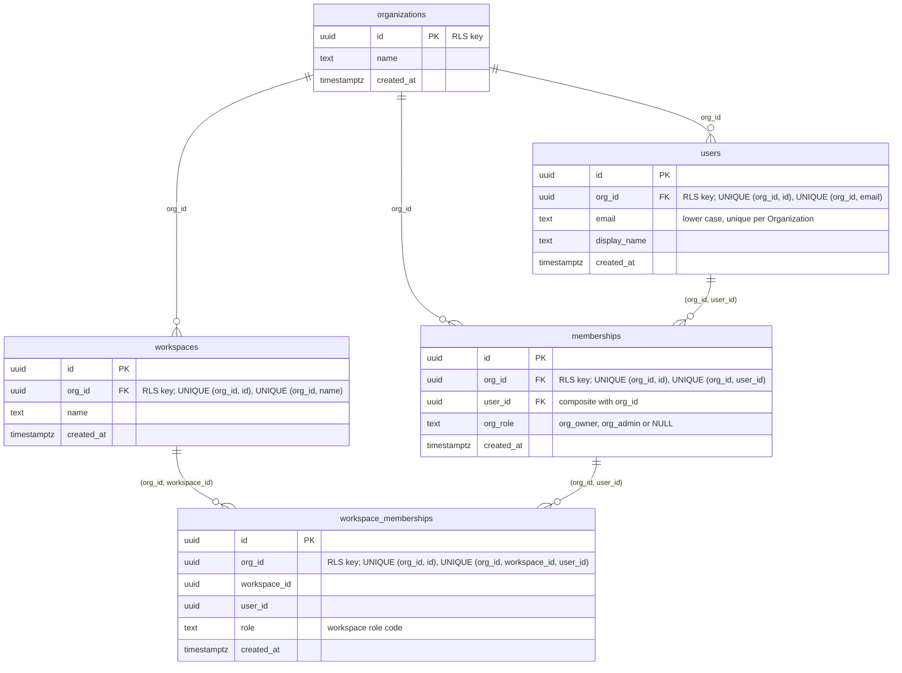

# Multi-tenant data model, row-level security and database roles

Status: accepted with the FND-01 review (EA-18), 2026-10-14. Implements decisions D6 (always multi-tenant), D32 (identity only from the verified token), D46 (two-layer tenant isolation), D48 (three-tier roles), D52 (masked logs) and ADR-001 sections 3.2, 5 (F1, F3) and 9.

## Purpose and status

FND-01 creates the first real database schema: the hierarchy Platform → Organization → Workspace, users and their memberships (a user belongs to one Organization), PostgreSQL row-level security (RLS) on every table, the split between a migration/owner role and the application role, and the tenant context a request gets only from a verified identity. A bug in application code must not be able to leak one customer's data to another: layer 1 is the explicit `org_id` filter in the code, layer 2 (this document) is the database.

Out of scope here, and where it lands: the full isolation suite with route discovery, jobs and cache keys (FND-02, EA-19); per-Organization encryption keys and vector partitions (FND-03, EA-20); creating Organizations, Workspaces and users and loading the demo manifest (FND-04, EA-21); sign-in and the admin session verifier (FND-05, EA-22); role-based permissions (FND-06); the Channel JWT verifier (WGT-03, EA-42); the masking helper (FND-08).

## Hierarchy



A user belongs to exactly one Organization (owner decision 2026-10-14): the same email in another Organization is another user, and nothing is unique across Organizations. RLS is per Organization (D46). A Workspace is a boundary inside an Organization: workspace-scoped tables carry `workspace_id` with the composite foreign key `(org_id, workspace_id) → workspaces(org_id, id)`; who may see which Workspace is decided in the application (FND-05 AC6, FND-06), not by RLS.

## Tables

All ids are `uuid`, generated by the database with `uuid_generate_v7()` (a SQL function created in the first migration: a random v4 UUID whose first 48 bits are replaced by the millisecond timestamp and whose version nibble is set to 7, RFC 9562). Tests may pass random v4 ids.

| Table | Columns and constraints |
|---|---|
| `organizations` | `id` PK, `name` NOT NULL, 1-200 characters, `created_at` |
| `workspaces` | `id` PK, `org_id` NOT NULL → `organizations(id)`, `name` NOT NULL 1-200, `created_at`; UNIQUE `(org_id, id)` (target of composite foreign keys), UNIQUE `(org_id, name)` |
| `users` | `id` PK, `org_id` NOT NULL → `organizations(id)`, `email` NOT NULL, lower case, 3-320 characters, `display_name` NOT NULL 1-200, `created_at`; UNIQUE `(org_id, id)`, UNIQUE `(org_id, email)` |
| `memberships` | `id` PK, `org_id` NOT NULL → `organizations(id)`, `user_id` NOT NULL, `org_role` NULL or `org_owner` / `org_admin` (NULL is a plain member), `created_at`; UNIQUE `(org_id, id)`, UNIQUE `(org_id, user_id)`; composite FK `(org_id, user_id) → users(org_id, id)` |
| `workspace_memberships` | `id` PK, `org_id`, `workspace_id`, `user_id` NOT NULL, `role` NOT NULL, `created_at`; UNIQUE `(org_id, id)`, UNIQUE `(org_id, workspace_id, user_id)`; composite FKs `(org_id, workspace_id) → workspaces(org_id, id)` and `(org_id, user_id) → memberships(org_id, user_id)` |

Role codes are snake case with CHECK constraints, so FND-06 can extend them with a migration; display names are i18n keys and are not stored. Organization roles (D48): `org_owner`, `org_admin`. Workspace roles (D48, D67): `workspace_admin`, `developer`, `builder`, `knowledge_editor`, `reviewer`, `viewer`, `member`.

## Tenant key rules

- Every table has `org_id uuid NOT NULL`, with one exception: `organizations`, whose tenant key is its own `id`.
- `users` is a normal tenant table (owner decision 2026-10-14, replacing the first design with a shared platform-level `users` table, which allowed one Organization to attach and read another's users). A person who works for two Organizations is two `users` rows. The application role has all four DML privileges; deleting a user goes through the normal tenant path (delete its memberships first).
- `alembic_version` is migration bookkeeping with no tenant data. It is ignored by the guard, and the application role has no privilege on it.
- The exceptions live in `ei_ai.db.schema_guard` (`TENANT_KEY`, `IGNORED_TABLES`), each with its reason, so a new exception shows up in a code review.

## Row-level security

Every table has `ENABLE ROW LEVEL SECURITY` and `FORCE ROW LEVEL SECURITY` (FORCE makes the table owner subject to the policies too), created in the same migration as the table. The policy on every table (the key is `id` on `organizations`, `org_id` elsewhere):

```sql
CREATE POLICY tenant_isolation ON workspaces
    USING (org_id = NULLIF(current_setting('app.current_org', true), '')::uuid)
    WITH CHECK (org_id = NULLIF(current_setting('app.current_org', true), '')::uuid);
```

- **NULLIF is required.** After a transaction that used `set_config(..., true)` has ended, `current_setting()` returns `''` (not NULL) in the same session, and `''::uuid` would raise an error instead of matching nothing. With NULLIF the key is NULL when there is no context, the comparison is NULL and no row is visible (fail closed). The integration test `test_policy_without_nullif_would_raise_on_empty_setting` demonstrates the difference on a temporary table; `test_every_table_returns_zero_rows_after_a_committed_tenant_transaction` covers every real table, `organizations` included.
- **No `TO <role>` clause.** The policy binds every role, the owner included (with FORCE); nothing is visible to anyone without a tenant context.
- **TRUNCATE is never granted:** it bypasses RLS.The application role gets SELECT, INSERT, UPDATE and DELETE only.
- **Composite foreign keys.** Referential-integrity checks bypass RLS, so a plain `id` reference could point at another Organization's row. References between tenant tables therefore include `org_id` on both sides, as in the table above.
- **No grants on partitions.** A direct query on a partition would skip the parent's policy; the future vector partitions (FND-03) get no grant, the application role queries the parent.
- **Views** use `security_invoker = true`; materialised views get no application privilege. **No `SECURITY DEFINER` functions** (they run with the owner's rights).
- **Errors leak no row data.** A rejected write raises SQLSTATE 42501 (`new row violates row-level security policy for table "x"`) which names the table only; this is asserted in `test_insert_without_context_is_rejected_without_row_values_in_error`. The API answers a missing or invalid identity with `401 {"detail": "unauthenticated"}` (an error code that frontends translate), never text, ids or SQL.

## Database roles

| Role | Attributes | Holds | Used by |
|---|---|---|---|
| `postgres` (bootstrap) | superuser | `POSTGRES_PASSWORD`, only in the `db` container | the first-start init scripts in `infra/db/init/`; nobody else |
| `ei_ai_migrator` | LOGIN, NOSUPERUSER, NOBYPASSRLS, NOCREATEDB, NOCREATEROLE; `CREATE` on schema `public` | owns every table, function and `alembic_version`; still subject to FORCE RLS | the `migrate` Compose service and the backend test container (`MIGRATION_DATABASE_URL`); never the API |
| `ei_ai_app` | LOGIN, NOSUPERUSER, NOBYPASSRLS, NOCREATEDB, NOCREATEROLE | never an owner, no DDL, only SELECT / INSERT / UPDATE / DELETE grants | the API and the integration tests (`DATABASE_URL`) |

"Elevated rights" means ownership and DDL: only the migration role has them. The `api` service has no `MIGRATION_*` variable and no `postgres` credential; `compose.test.mjs` checks this. Migrations refuse to run as a superuser or as `ei_ai_app` (`check_migration_role`). Role passwords are fixed when the database volume is first created, so a database created before FND-01 needs a one-time `npm run reset`.

## Migrations

Alembic is configured in code (no `alembic.ini`); the revisions are packaged in `ei_ai.db.migrations`, so the runtime image can run them. `ei-ai db upgrade` runs `upgrade head` as the migration role and then the schema guard; it exits 1 when the guard finds a violation. The guard is a CI and review gate: it judges the schema after the migrations were committed and does not undo them. Migrations refuse to run as anything but `ei_ai_migrator`.

- `npm run up` starts the database, runs the `migrate` service, then starts the rest. `npm run migrate` runs only the migrations and is safe to repeat. `npm run backend -- test-integration` and `bench-rls` migrate before they run tests. The CI `stack` job runs `npm run up` and the integration tests, so CI applies and guards the migrations on a fresh database.
- Policy and grants go through the helpers in `ei_ai.db.migrations.rls` (`enable_tenant_rls`, `grant_dml`) so the pattern cannot drift.
- `downgrade()` is implemented for revision 0001. It is not run by automated tests (it would wipe the shared local database); `python -m ei_ai.db.migrate roundtrip` (downgrade to base, then upgrade) exists for a one-time check, refuses to run unless `EI_AI_ENV` is `local` or `test`, and is not exposed through `ei-ai` or an npm script.

### Schema guard (rules)

`ei_ai.db.schema_guard.find_violations` judges a snapshot of the catalog (`ei_ai.db.catalog`). Each rule has a stable code; messages name the object and the rule only.

| Code | Rule |
|---|---|
| G1 | the tenant key exists, is `uuid` and NOT NULL |
| G2 | RLS is ENABLED and FORCED |
| G3 | at least one policy |
| G4 | every permissive policy expression equals the standard tenant expression exactly (permissive policies are OR-ed, so any extra policy, `OR true` or subquery could widen access); restrictive policies may only narrow and are allowed |
| G5 | a permissive `FOR ALL` policy with the standard expression on the tenant key exists |
| G6 | the migration role owns the object, never the application role |
| G7 | application-role privileges are a subset of SELECT, INSERT, UPDATE, DELETE |
| G8 | no application-role privilege on partitions or on ignored tables |
| G9 | views are `security_invoker`; materialised views have no application privilege |
| G10 | functions are owned by the migration role and are not SECURITY DEFINER |
| G11 | a foreign key between tenant tables pairs the tenant key with the tenant key, column by column |
| G12 | a table without the tenant key must be a listed ignored table (this is the "new table lacks `org_id`" case) |

### Checklist: adding a table

1. `org_id uuid NOT NULL REFERENCES organizations (id)` (or add the table to the guard's ignored list with a reason, reviewed).
2. In the same migration: `enable_tenant_rls("<table>")` and `grant_dml("<table>")`.
3. Foreign keys to other tenant tables are composite on `(org_id, ...)`, with a `UNIQUE (org_id, id)` on the referenced table.
4. Add the table to the cross-org fixtures of `backend/tests/integration/db/` (`test_fixture_tables_cover_every_tenant_table` fails until you do; FND-02 extends this suite).
5. Run `npm run migrate`: the guard must report `0 violations`.

## Tenant context flow

1. An `IdentityVerifier` (`ei_ai.auth.principal`) turns a request into a verified `Principal(user_id, org_id)` or `None` (not its kind of credential) or raises `InvalidCredentials`. The admin session (FND-05) and the Channel JWT (WGT-03) will each add one.
2. `current_principal` (`ei_ai.auth.dependencies`) runs the configured verifiers; the first match wins. **Production has no verifier yet, so every tenant route answers 401 (fail closed).** Tests use a test-only verifier under `backend/tests/support/`, never shipped.
3. `require_tenant` (`ei_ai.tenancy.context`) returns the Principal's Organization. It is a FastAPI dependency, not middleware: per route, explicit and testable.
4. `tenant_session` / `tenant_transaction` (`ei_ai.db.tenant`) open a top-level transaction and run `SELECT set_config('app.current_org', <org id>, true)`. The setting is transaction-local, so it is gone on commit and rollback and cannot leak to the next user of a pooled connection. Routes get the session through `TenantSession` (`ei_ai.api.deps`), a function-scoped dependency: the transaction commits when the route function returns, before the response is sent, so a failing commit gives an error response and never a 2xx (`test_a_commit_failure_is_an_error_response_not_a_2xx`). The helper refuses to run when a transaction is already open (a nested call would only create a SAVEPOINT and the setting would outlive it) and rejects anything that is not a `uuid.UUID`.
5. **A client-supplied `org_id` is never used.** The headers `X-Org-Id`, `X-Organization-Id`, `X-Tenant-Id` and the query parameters `org_id`, `orgId`, `organization_id`, `tenant_id` are ignored. A value that differs from the Principal's Organization (or is not a UUID) logs one warning `tenant_override_ignored` with the source, the configured field name, the route template and the Principal's Organization id; the supplied value is never logged. Request models must not declare `org_id`; FND-02 tests every route for this.
6. `GET /organization` returns `{id, name}` of the Principal's Organization, read through the tenant session (explicit filter plus RLS). In the running stack it answers 401 until a verifier exists.

## Follow-ups

- FND-02 (EA-19): the full isolation suite (route discovery, jobs, cache keys) on top of the fixtures here.
- FND-03 (EA-20): vector partitions and per-Organization keys; partitions get no grants.
- FND-04 (EA-21) and FND-05 (EA-22): looking up a user by email before sign-in (the Organization is not known yet) is impossible for the application role under these policies and needs a narrow, reviewed addition (a policy or a dedicated platform role, with a reviewed addition to the guard configuration, `IGNORED_TABLES` or `TENANT_KEY` in `ei_ai.db.schema_guard`, and a reason). Inviting a person to a second Organization creates a second user row in that Organization. Deleting a user in the product goes through the normal tenant path as the application role; row-level security is never altered, not even by test cleanup (a unit test rejects `NO FORCE` and `DISABLE ROW LEVEL SECURITY` anywhere under `backend/src`).
- FND-06: extend the role codes with a migration; permissions are checked in the application.
- WGT-03 (EA-42): the Channel JWT verifier derives the Organization from the Channel.

## RLS overhead

The non-functional requirement, restated by the owner on 2026-10-14 (now in the EA-18 description): on a 100 000-row table, measured once, RLS adds **at most 1 ms per query, or at most 10 % for queries that take 10 ms or more without RLS**. This replaces the first wording ("less than 10 %"), which the measurements below show is not a sensible limit for sub-millisecond queries. The benchmark is `backend/tests/perf/test_rls_overhead.py` (`npm run backend -- bench-rls`; excluded from the unit and integration runs, from `npm run check` and from CI). The rule is the pure function `within_rls_budget` in `backend/tests/support/overhead.py`, unit-tested in `backend/tests/perf/test_overhead_rule.py`.

Method: two identical temporary tables with 100 000 rows over 10 Organizations (10 000 each), primary key `(org_id, id)` and an index on `(id)`, one with ENABLE + FORCE RLS and the production policy, one without. The same role and the same kind of tenant transaction for both (the setting is set in both; only the policy differs). Three query shapes; 20 warm-up and 200 measured `EXPLAIN (ANALYZE, FORMAT JSON)` runs each, alternating between the tables; the rule is applied to the medians of the Execution Time. Planning time is shown for information.

Result, 2026-10-14, development machine (12 CPUs, Docker Desktop with WSL2, PostgreSQL 16.15), medians in ms (raw output: `.work/EA-18/rls-bench.txt`, kept out of git):

| Shape | Exec off | Exec on | Added | Relative | Rule |
|---|---|---|---|---|---|
| org-scoped aggregate (10 000 rows) | 2.4245 | 2.8820 | 0.4575 ms | 18.9 % | met (under 1 ms) |
| org-scoped page (`ORDER BY id LIMIT 50`) | 0.0250 | 0.0300 | 0.0050 ms | 20.0 % | met (under 1 ms) |
| point lookup by id | 0.0090 | 0.0110 | 0.0020 ms | 22.2 % | met (under 1 ms) |

The requirement is met: every shape adds well under 1 ms, and no shape has a baseline of 10 ms or more, so the 10 % branch did not come into play. For information: the same aggregate was measured at +20.6 % to +21.2 % (about 0.47 ms) in three earlier runs, and the relative figures of the two sub-0.04 ms shapes are noisy (EXPLAIN timings have a resolution of 1 microsecond). The relative cost is probably the one-time filter that PostgreSQL puts on a `Result` node above the scan (not proven); wrapping the setting in a scalar sub-select gave the same overhead, so the policy text is unchanged. Re-measure when the tables or the policy change, for example when FND-03 adds vector partitions.
