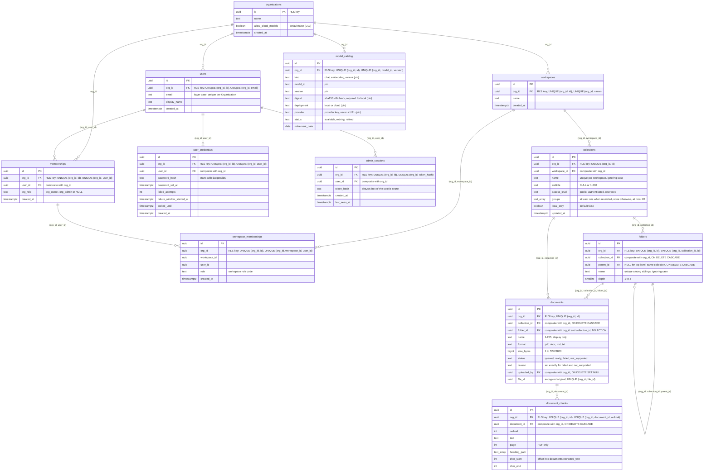

# Multi-tenant data model, row-level security and database roles

Status: accepted with the FND-01 review (EA-18), 2026-10-14. Implements decisions D6 (always multi-tenant), D32 (identity only from the verified token), D46 (two-layer tenant isolation), D48 (three-tier roles), D52 (masked logs) and ADR-001 sections 3.2, 5 (F1, F3) and 9.

## Purpose and status

FND-01 creates the first real database schema: the hierarchy Platform → Organization → Workspace, users and their memberships (a user belongs to one Organization), PostgreSQL row-level security (RLS) on every table, the split between a migration/owner role and the application role, and the tenant context a request gets only from a verified identity. A bug in application code must not be able to leak one customer's data to another: layer 1 is the explicit `org_id` filter in the code, layer 2 (this document) is the database.

Out of scope here, and where it lands: sign-in and the admin session verifier (FND-05, EA-22); role-based permissions (FND-06); the Channel JWT verifier (WGT-03, EA-42); the masking helper (FND-08).

## Hierarchy



A user belongs to exactly one Organization (owner decision 2026-10-14): the same email in another Organization is another user, and nothing is unique across Organizations except the Organization name (see "Platform plane: provisioning"). RLS is per Organization (D46). A Workspace is a boundary inside an Organization: workspace-scoped tables carry `workspace_id` with the composite foreign key `(org_id, workspace_id) → workspaces(org_id, id)`; who may see which Workspace is decided in the application (FND-05 AC6, FND-06), not by RLS.

## Tables

All ids are `uuid`, generated by the database with `uuid_generate_v7()` (a SQL function created in the first migration: a random v4 UUID whose first 48 bits are replaced by the millisecond timestamp and whose version nibble is set to 7, RFC 9562). Tests may pass random v4 ids.

| Table | Columns and constraints |
|---|---|
| `organizations` | `id` PK, `name` NOT NULL, 1-200 characters, `allow_cloud_models` boolean NOT NULL default false (the Organization's "Allow cloud models" switch, D17; revision 0005), `created_at`; unique index `organizations_name_lower_key` on `lower(name)` (revision 0002) |
| `workspaces` | `id` PK, `org_id` NOT NULL → `organizations(id)`, `name` NOT NULL 1-200, `created_at`; UNIQUE `(org_id, id)` (target of composite foreign keys), UNIQUE `(org_id, name)` |
| `users` | `id` PK, `org_id` NOT NULL → `organizations(id)`, `email` NOT NULL, lower case, 3-320 characters, `display_name` NOT NULL 1-200, `created_at`; UNIQUE `(org_id, id)`, UNIQUE `(org_id, email)` |
| `memberships` | `id` PK, `org_id` NOT NULL → `organizations(id)`, `user_id` NOT NULL, `org_role` NULL or `org_owner` / `org_admin` (NULL is a plain member), `created_at`; UNIQUE `(org_id, id)`, UNIQUE `(org_id, user_id)`; composite FK `(org_id, user_id) → users(org_id, id)` |
| `workspace_memberships` | `id` PK, `org_id`, `workspace_id`, `user_id` NOT NULL, `role` NOT NULL, `created_at`; UNIQUE `(org_id, id)`, UNIQUE `(org_id, workspace_id, user_id)`; composite FKs `(org_id, workspace_id) → workspaces(org_id, id)` and `(org_id, user_id) → memberships(org_id, user_id)` |
| `audit_events` (0002) | `id` PK, `org_id` NOT NULL → `organizations(id)`, `actor` 1-100 characters, `action` a dotted code (`^[a-z_]+(\.[a-z_]+)+$`), `target_type` `organization` / `workspace` / `user` / `model` / `collection` / `folder` / `document` (`model` since 0005, `collection` and `folder` since 0007, `document` since 0010), `target_id` uuid, `workspace_id` uuid NULL, `old_value` / `new_value` NULL or a code (`^[a-z_]{1,40}$`: a role code, an access level or a data-handling code; NULL = none; the three columns since 0006, EA-23: where something changed and from what to what), `created_at`; UNIQUE `(org_id, id)`. `workspace_id` has no foreign key: audit rows outlive their targets. No free text and no personal data (D52) |
| `collections` (0007, EA-32) | `id` PK, `org_id` NOT NULL → `organizations(id)`, `workspace_id` NOT NULL, `name` 1-200, `subtitle` NULL or 1-200, `access_level` `public` / `authenticated` / `restricted`, `groups` text[] NOT NULL default `{}` (stored normalised by the service), `local_only` bool default false, `created_at`, `updated_at`; CHECK `(access_level = 'restricted') = (cardinality(groups) >= 1)` and `cardinality(groups) <= 20`; UNIQUE `(org_id, id)`; composite FK `(org_id, workspace_id) → workspaces(org_id, id)`; unique index `collections_workspace_name_key` on `(org_id, workspace_id, lower(name))`; index `(org_id, workspace_id)` |
| `folders` (0007, EA-32) | `id` PK, `org_id` NOT NULL → `organizations(id)`, `collection_id` NOT NULL, `parent_id` NULL (top level), `name` 1-200, `depth` smallint 1-3, `created_at`; UNIQUE `(org_id, id)`, UNIQUE `(org_id, collection_id, id)`; composite FK `(org_id, collection_id) → collections(org_id, id)` ON DELETE CASCADE; composite FK `(org_id, collection_id, parent_id) → folders(org_id, collection_id, id)` ON DELETE CASCADE (a parent lies in the same collection); unique index `folders_sibling_name_key` on `(org_id, collection_id, COALESCE(parent_id, nil uuid), lower(name))` |
| `documents` (0010, EA-33) | `id` PK, `org_id` NOT NULL → `organizations(id)`, `collection_id` NOT NULL, `folder_id` NOT NULL, `name` 1-255 (display only, never in a path), `format` `pdf` / `docx` / `md` / `txt`, `size_bytes` bigint 1-52 428 800, `status` `queued` / `ready` / `failed` / `not_supported` (`processing` is not stored: it comes from the in-process runner), `reason` NULL or `scanned_pdf` / `corrupt_file` / `password_protected` / `no_text` / `unreadable_encoding` / `file_too_complex` / `processing_error`, NOT NULL exactly when the status is `failed` or `not_supported`, `page_count` NULL (>= 0), `chunk_count` default 0, `extracted_text` NULL (the normalised full text; chunk offsets index into it), `uploaded_by` NULL, `file_id` NOT NULL (the stored original, made by `OrgFileStore`; never in an API response), `created_at`, `updated_at`, `processed_at` NULL; UNIQUE `(org_id, id)`, UNIQUE `(org_id, file_id)`; composite FK `(org_id, collection_id) → collections(org_id, id)` ON DELETE CASCADE; composite FK `(org_id, collection_id, folder_id) → folders(org_id, collection_id, id)` with no cascade (a folder that holds documents cannot be deleted on its own; a collection delete removes both in one statement); composite FK `(org_id, uploaded_by) → users(org_id, id)` ON DELETE SET NULL (uploaded_by); index `(org_id, collection_id, folder_id, created_at DESC)` |
| `document_chunks` (0010, EA-33) | `id` PK, `org_id` NOT NULL → `organizations(id)`, `document_id` NOT NULL, `ordinal` >= 0, `text` NOT NULL, `page` NULL (PDF only, 1-based), `heading_path` text[] default `{}`, `char_start` >= 0, `char_end` > `char_start` (offsets into `documents.extracted_text`), `token_estimate` > 0, `created_at`; UNIQUE `(org_id, id)`, UNIQUE `(org_id, document_id, ordinal)`; composite FK `(org_id, document_id) → documents(org_id, id)` ON DELETE CASCADE |
| `set_password_tokens` (0002) | `id` PK, `org_id` NOT NULL → `organizations(id)`, `user_id`, `token_hash` 64 lower-case hex (SHA-256 of the secret; the secret is never stored), `expires_at`, `used_at` NULL until redeemed, `created_at`; UNIQUE `(org_id, id)`, UNIQUE `(org_id, token_hash)`; composite FK `(org_id, user_id) → users(org_id, id)` |
| `user_credentials` (0003) | `id` PK, `org_id` NOT NULL → `organizations(id)`, `user_id`, `password_hash` NOT NULL, must start with `$argon2id$`, `password_set_at` (default now()), `failed_attempts` int NOT NULL default 0, >= 0, `failure_window_started_at` NULL, `locked_until` NULL, `created_at`; UNIQUE `(org_id, id)`, UNIQUE `(org_id, user_id)`; composite FK `(org_id, user_id) → users(org_id, id)`. No row: the user has never set a password |
| `admin_sessions` (0003) | `id` PK, `org_id` NOT NULL → `organizations(id)`, `user_id`, `token_hash` 64 lower-case hex (SHA-256 of the cookie secret; the secret is never stored), `created_at`, `last_seen_at` (default now()); UNIQUE `(org_id, id)`, UNIQUE `(org_id, token_hash)`; index `(org_id, user_id)`; composite FK `(org_id, user_id) → users(org_id, id)` |
| `model_catalog` (0005, EA-24) | `id` PK, `org_id` NOT NULL → `organizations(id)`, `kind` `chat` / `embedding` / `rerank`, `display_name` 1-200, `model_id` `^[a-z0-9][a-z0-9._-]{0,99}$`, `version` `^[a-z0-9][a-z0-9._-]{0,39}$`, `digest` NULL or `sha256:<64 hex>` (required when `deployment = local`), `source_revision` NULL or 1-500 (publisher repo @ revision / file), `deployment` `local` / `cloud`, `provider` a provider key `^[a-z0-9][a-z0-9-]{0,49}$` (no URL column: a key maps to a configured base URL, P35), `vietnamese_quality` NULL or `good` / `fair` / `poor`, `vietnamese_quality_measured` bool default false, `tool_use` bool default false, `context_window` NULL or > 0, `speed` NULL or `faster` / `slower`, `status` `available` (default) / `retiring` (needs `retirement_date`) / `retired`, `retirement_date` NULL, `created_at`; UNIQUE `(org_id, id)`, UNIQUE `(org_id, model_id, version)`. Trigger `model_catalog_pin_immutable` (BEFORE UPDATE, SECURITY INVOKER, owned by the migrator) rejects any change of the pin columns `kind`, `model_id`, `version`, `digest`, `source_revision`, `deployment`, `provider` for every role (`model_catalog pin columns are immutable`): a new model file is always a new row (D18). See `docs/architecture/model-gateway.md` |
| `organization_keys` (0008, EA-20) | `id` PK, `org_id` NOT NULL → `organizations(id)`, `wrapped_key` bytea NULL (exactly 60 bytes while live, NULL after destruction), `kek_id` 16 lower-case hex characters, `created_at`, `destroyed_at` NULL (set if and only if `wrapped_key` is NULL); UNIQUE `(org_id)`, UNIQUE `(org_id, id)`. One wrapped data key per Organization; see `docs/architecture/key-management.md` |
| `chunk_embeddings` (0009, EA-20) | partitioned `BY LIST (org_id)`: `org_id` NOT NULL → `organizations(id)`, `id` (default `uuid_generate_v7()`), `embedding vector(1024)` NOT NULL, `created_at`; PK `(org_id, id)`; RLS and DML grants on the parent. One partition per Organization, `chunk_embeddings_<org id as 32 hex>`, owned by `ei_ai_migrator`, with its own `hnsw` index and **no grant** to `ei_ai_app`; no DEFAULT partition. The operator creates it with `ei-ai db vector-partition --org ORG_ID` (migrator plane). Creating or dropping one briefly takes an ACCESS EXCLUSIVE lock on the parent. See `docs/architecture/key-management.md` |

Role codes are snake case with CHECK constraints, so FND-06 can extend them with a migration; display names are i18n keys and are not stored. Organization roles (D48): `org_owner`, `org_admin`. Workspace roles (D48, D67): `workspace_admin`, `developer`, `builder`, `knowledge_editor`, `reviewer`, `viewer`, `member`.

### Stored originals (EA-33)

The original file of a document is not in the database: `OrgFileStore` (EA-20, `ei_ai.storage.files`) keeps it encrypted with the Organization's data key at `<FILE_STORAGE_ROOT>/<org_id>/<file_id>.bin` (default root `/var/lib/ei-ai/files`, the `kb-files` volume of the `api` service; see [key-management.md](key-management.md)). `documents.file_id` names it; the store makes the id, and the path is built from the verified `TenantContext` or `JobContext` and that `uuid.UUID` only, so the user's file name never reaches a path and a row of one Organization can only name a file under its own directory. Upload stores the file first and deletes it again if the row cannot be written; remove and collection delete delete the files by `file_id` after the commit (no key needed, so this also works after the key was destroyed). The ingestion job reads the file id from the Organization's own `queued` row; a missing file, a missing or destroyed key or a foreign blob ends the document `failed` / `processing_error`. The quota counts `size_bytes` (plaintext), not the 32-byte overhead per file.

## Tenant key rules

- Every table has `org_id uuid NOT NULL`, with one exception: `organizations`, whose tenant key is its own `id`.
- `users` is a normal tenant table (owner decision 2026-10-14, replacing the first design with a shared platform-level `users` table, which allowed one Organization to attach and read another's users). A person who works for two Organizations is two `users` rows. The application role has all four DML privileges; deleting a user goes through the normal tenant path (delete its memberships first).
- `alembic_version` is migration bookkeeping with no tenant data. It is ignored by the guard, and the application role has no privilege on it.
- The exceptions live in `ei_ai.db.schema_guard` (`TENANT_KEY`, `IGNORED_TABLES`), each with its reason, so a new exception shows up in a code review.

## Row-level security

Every table has `ENABLE ROW LEVEL SECURITY` and `FORCE ROW LEVEL SECURITY` (FORCE makes the table owner subject to the policies too), created in the same migration as the table. The policy on every table (the key is `id` on `organizations`, `org_id` elsewhere):

```sql
CREATE POLICY tenant_isolation ON workspaces
    USING (org_id = NULLIF(current_setting('app.current_org', true), '')::uuid)
    WITH CHECK (org_id = NULLIF(current_setting('app.current_org', true), '')::uuid);
```

- **NULLIF is required.** After a transaction that used `set_config(..., true)` has ended, `current_setting()` returns `''` (not NULL) in the same session, and `''::uuid` would raise an error instead of matching nothing. With NULLIF the key is NULL when there is no context, the comparison is NULL and no row is visible (fail closed). The integration test `test_policy_without_nullif_would_raise_on_empty_setting` demonstrates the difference on a temporary table; `test_every_table_returns_zero_rows_after_a_committed_tenant_transaction` covers every real table, `organizations` included.
- **No `TO <role>` clause.** The policy binds every role, the owner included (with FORCE); nothing is visible to anyone without a tenant context. The one reviewed exception is the sign-in lookup policy on `users` (below), which binds only `ei_ai_signin`.
- **TRUNCATE is never granted:** it bypasses RLS.The application role gets SELECT, INSERT, UPDATE and DELETE only.
- **Composite foreign keys.** Referential-integrity checks bypass RLS, so a plain `id` reference could point at another Organization's row. References between tenant tables therefore include `org_id` on both sides, as in the table above.
- **No grants on partitions.** A direct query on a partition would skip the parent's policy; the future vector partitions (FND-03) get no grant, the application role queries the parent.
- **Views** use `security_invoker = true`; materialised views get no application privilege. **No `SECURITY DEFINER` functions** (they run with the owner's rights).
- **Errors leak no row data.** A rejected write raises SQLSTATE 42501 (`new row violates row-level security policy for table "x"`) which names the table only; this is asserted in `test_insert_without_context_is_rejected_without_row_values_in_error`. The API answers a missing or invalid identity with `401 {"detail": "unauthenticated"}` (an error code that frontends translate), never text, ids or SQL.

## Database roles

| Role | Attributes | Holds | Used by |
|---|---|---|---|
| `postgres` (bootstrap) | superuser | `POSTGRES_PASSWORD`, only in the `db` container | the first-start init scripts in `infra/db/init/`; nobody else |
| `ei_ai_migrator` | LOGIN, NOSUPERUSER, NOBYPASSRLS, NOCREATEDB, NOCREATEROLE; `CREATE` on schema `public` | owns every table, function and `alembic_version`; still subject to FORCE RLS | the `migrate` Compose service and the backend test container (`MIGRATION_DATABASE_URL`); never the API |
| `ei_ai_app` | LOGIN, NOSUPERUSER, NOBYPASSRLS, NOCREATEDB, NOCREATEROLE | never an owner, no DDL, only SELECT / INSERT / UPDATE / DELETE grants | the API and the integration tests (`DATABASE_URL`) |
| `ei_ai_signin` | LOGIN, NOSUPERUSER, NOBYPASSRLS, NOCREATEDB, NOCREATEROLE, NOINHERIT; `CONNECT` and `USAGE` on schema `public` | never an owner, member of no role; its only data access is `SELECT (id, org_id, email) ON users` and the `sign_in_lookup` policy (it keeps the PostgreSQL PUBLIC defaults: `TEMP` on the database, `EXECUTE` on functions) | `ei_ai.auth.directory` in the API, and the proof tests (`SIGNIN_DATABASE_URL`); never the migrate service or the CLI |

"Elevated rights" means ownership and DDL: only the migration role has them. The `api` service has no `MIGRATION_*` variable and no `postgres` credential; `compose.test.mjs` checks this, and that only `api` and `backend-tools` get `SIGNIN_DATABASE_URL` (`db` gets only `SIGNIN_DB_PASSWORD` for its init script). Migrations refuse to run as a superuser, as `ei_ai_app` or as `ei_ai_signin` (`check_migration_role`). Role passwords are fixed when the database volume is first created, so a database created before FND-01 needs a one-time `npm run reset`, and one created before EA-22 needs it once more for `ei_ai_signin` (`infra/db/init/030-signin-role.sh`).

### Sign-in lookup role (EA-22, owner decision 2026-10-20)

Sign-in knows an email and a password, not the Organization, and every `users` row is invisible until the tenant is known. The owner chose (spec ruling R42) a dedicated, read-only login role as the **only cross-tenant read in the codebase**, as narrow as possible:

- **Grant** (migration `0004`): only `GRANT SELECT (id, org_id, email) ON users TO ei_ai_signin`. No table-level privilege, no other table, column, write or grant option. Like every role it keeps the PostgreSQL PUBLIC defaults: `TEMP` on the database (temporary tables in its own session) and `EXECUTE` on functions; neither gives access to any table data, and it cannot create objects in schema `public`.
- **Policy** (migration `0004`): `CREATE POLICY sign_in_lookup ON users AS PERMISSIVE FOR SELECT TO ei_ai_signin USING (true)`. It binds only that role; `ei_ai_app` and `ei_ai_migrator` still see no `users` row without `app.current_org` (FORCE RLS unchanged). It is the only policy in the schema with a `TO` clause.
- **Guard allowance:** `SIGN_IN_LOOKUP_ALLOWANCE` in `ei_ai.db.schema_guard` matches it field by field (table `users`, policy `sign_in_lookup`, roles `{ei_ai_signin}`, command `SELECT`, expression `true`, no `WITH CHECK`) with its reason; G4 skips that policy and nothing else. G14 requires the role's privileges to be exactly the three column privileges (PUBLIC grants count as its own, since every role holds them).
- **Connection:** only `ei_ai.auth.directory.SignInDirectory` connects with `SIGNIN_DATABASE_URL` (private engine, pool of 2, one query: `SELECT org_id, id FROM users WHERE email = :email ORDER BY org_id LIMIT 10`; never a tenant transaction). `tests/test_sign_in_directory_imports.py` fails when another module reads the setting or the variable, or imports the directory (allowed: `main.py`, `api/auth.py`, `auth/sign_in.py`, `auth/password_reset.py`). Everything after the lookup runs as `ei_ai_app` in the candidate Organization's tenant transaction.
- **Proof tests** (`tests/integration/db/test_sign_in_role.py`, isolation suite, connected as `ei_ai_signin`): reads `id, org_id, email` of two Organizations; `display_name`, `*`, every other table and `alembic_version` are denied; INSERT, UPDATE, DELETE, TRUNCATE and CREATE TABLE are denied; the role attributes are as above. `tests/integration/db/test_roles.py` checks it owns nothing, is a member of no role and holds no privilege beyond the three columns.

Any further use or widening of this role is a review blocker.

## Migrations

Alembic is configured in code (no `alembic.ini`); the revisions are packaged in `ei_ai.db.migrations`, so the runtime image can run them. `ei-ai db upgrade` runs `upgrade head` as the migration role and then the schema guard; it exits 1 when the guard finds a violation. The guard is a CI and review gate: it judges the schema after the migrations were committed and does not undo them. Migrations refuse to run as anything but `ei_ai_migrator`.

- `npm run up` starts the database, runs the `migrate` service, then starts the rest. `npm run migrate` runs only the migrations and is safe to repeat. `npm run backend -- test-integration` and `bench-rls` migrate before they run tests. The CI `stack` job runs `npm run up` and the integration tests, so CI applies and guards the migrations on a fresh database.
- Policy and grants go through the helpers in `ei_ai.db.migrations.rls` (`enable_tenant_rls`, `grant_dml`) so the pattern cannot drift.
- `downgrade()` is implemented for revisions 0001, 0002, 0003 and 0004. It is not run by automated tests (it would wipe the shared local database); `python -m ei_ai.db.migrate roundtrip` (downgrade to base, then upgrade) exists for a one-time check, refuses to run unless `EI_AI_ENV` is `local` or `test`, and is not exposed through `ei-ai` or an npm script.

### Schema guard (rules)

`ei_ai.db.schema_guard.find_violations` judges a snapshot of the catalog (`ei_ai.db.catalog`). Each rule has a stable code; messages name the object and the rule only.

| Code | Rule |
|---|---|
| G1 | the tenant key exists, is `uuid` and NOT NULL |
| G2 | RLS is ENABLED and FORCED |
| G3 | at least one policy |
| G4 | every permissive policy expression equals the standard tenant expression exactly and has no `TO` clause (permissive policies are OR-ed, so any extra policy, `OR true` or subquery could widen access); the only exception is the exact `SIGN_IN_LOOKUP_ALLOWANCE` (another name, role, table, command or expression still fails); restrictive policies may only narrow and are allowed (G13 still constrains how they read the setting) |
| G5 | a permissive `FOR ALL` policy with the standard expression on the tenant key exists |
| G6 | the migration role owns the object, never the application role |
| G7 | application-role privileges are a subset of SELECT, INSERT, UPDATE, DELETE |
| G8 | no application-role privilege on partitions or on ignored tables |
| G9 | views are `security_invoker`; materialised views have no application privilege |
| G10 | functions are owned by the migration role and are not SECURITY DEFINER |
| G11 | a foreign key between tenant tables pairs the tenant key with the tenant key, column by column |
| G12 | a table without the tenant key must be a listed ignored table (this is the "new table lacks `org_id`" case) |
| G13 | a restrictive policy may read `app.current_org` only through the standard `NULLIF(..., '')::uuid` form (it cannot widen access, but without NULLIF it errors on `''` instead of failing closed) |
| G14 | `ei_ai_signin` holds exactly the column privileges `SELECT (email, id, org_id)` on `users`, without grant option, and no other table, column or privilege; a grant to `PUBLIC` counts as its own |

### Checklist: adding a table

1. `org_id uuid NOT NULL REFERENCES organizations (id)` (or add the table to the guard's ignored list with a reason, reviewed).
2. In the same migration: `enable_tenant_rls("<table>")` and `grant_dml("<table>")`.
3. Foreign keys to other tenant tables are composite on `(org_id, ...)`, with a `UNIQUE (org_id, id)` on the referenced table.
4. Add the table to the cross-org fixtures: `create_org_rows`, `OrgRows`, `UPDATE_SETS` and `DELETE_ORDER` in `backend/tests/support/tenants.py`, `FORGED_INSERTS` in `test_rls_cross_org.py`, and `backend/tests/integration/db/` (`test_fixture_tables_cover_every_tenant_table` fails until you do). The tenant-isolation suite (FND-02) snapshots and cleans up through the same list.
5. If the table is partitioned per Organization (like `chunk_embeddings`), the cross-org fixtures must also create the Organization's partition after the Organization row exists (`create_vector_partition` over an owner-role connection, as `create_org_rows` does) and drop it on cleanup (`purge_org_ids`), because there is no DEFAULT partition and the application role has no DDL. Partitions get no grants.
6. Run `npm run migrate`: the guard must report `0 violations`.

## Platform plane: provisioning (FND-04)

The Platform Operator creates Organizations, Workspaces and users with the `ei-ai` CLI inside the API container (`ei_ai.provisioning`; README, "Platform Operator CLI"). This is the platform plane: there is no request and no token, so the Organization id comes from the operator's command line (or, for `org create`, from `uuid_generate_v7()`). It is reachable only with shell access to the API container and the database credentials, and `ei_ai.provisioning` is imported only by `ei_ai/cli.py` and `ei_ai/seed/` (`tests/test_provisioning_imports.py` fails on any other importer, relative imports included; a dynamic `importlib` import is invisible to it and is a review rule), so no HTTP route can pass a client-sent Organization id to it (D32, D46). Every write still runs as `ei_ai_app` in a `tenant_transaction` for the target Organization, with the explicit `org_id` filter on every statement; nothing here needs an RLS exemption or a guard exception.

- **Unique Organization names.** `organizations_name_lower_key` (unique on `lower(name)`) is a deliberate, platform-wide constraint so the operator cannot create two "Mekong Devworks". It is not an exemption: rows of other Organizations stay invisible, and a duplicate insert only fails with a unique violation that the CLI turns into `an Organization with this name already exists` (never the key values). Only the CLI inserts Organizations; no route does. It reveals whether a name exists to the operator, who already has database credentials.
- **Self-locating set-password token.** A link carries `#token=<org_id>.<secret>` in the URL fragment (`/set-password#token=...`, `ei_ai.auth.set_password`): a fragment is never sent to a server, so the secret cannot reach the admin nginx access log, a proxy or a Referer header; the FND-05 page reads it from `location.hash` and POSTs it. The redeemer takes the Organization from the token, opens a tenant transaction for it and matches `sha256(secret)` inside that Organization only, so a secret paired with another Organization's id matches nothing; no platform-wide token table and no pre-sign-in cross-tenant lookup is needed. Tokens are valid 24 hours and single-use: `redeem_set_password_token(engine, token)` atomically sets `used_at` on an unused, unexpired token and returns the user id, otherwise `None` (unknown, used, expired, malformed and wrong-Organization tokens look the same). FND-05 (EA-22) calls it from the set-password page. Issuing a new link deletes the user's earlier unused tokens.
- **Audit events.** Every successful command writes its events (actor `platform-operator`, action, target) through `ei_ai.audit.events.record_event(…, PLATFORM_OPERATOR, …)` in the same transaction as its rows; a failed command writes nothing. `audit_events` has the standard DML grants like every table (the fixtures and cleanup rely on them) and is append-only by convention: no code path updates or deletes it. FND-08 (EA-25) revokes UPDATE and DELETE and adds retention and the viewer.
- **Demo seed.** `ei-ai seed demo` loads one manifest per Organization (Mekong Devworks, fixed id `0192a000-0000-7000-8000-00000000ea21`; Sông Hàn Retail, `0192a000-0000-7000-8000-00000000ea94`), each in its own tenant transaction, so it finds an earlier load inside that Organization; it is refused outside `local`/`test`, so the public id never exists in production.

## Known limitation: global ids

Primary keys are global (`id`, unique across Organizations), so an INSERT in Organization A that supplies an `id` which exists in Organization B hits the unique index, and the error tells the caller the id exists (EA-18 review R2-1). Mitigations instead of changing every key to `(org_id, id)`: ids are generated by the database (`uuid_generate_v7()`, 74 random bits) and unguessable; the tenant-isolation suite fails when a request body declares `id`, so a client never chooses a primary key; and the suite requires an id of another Organization to be answered exactly like an unknown id (same status and body), so the API never reveals existence.

## Tenant context flow

1. An `IdentityVerifier` (`ei_ai.auth.principal`) turns a request into a verified `Principal(user_id, org_id)` or `None` (not its kind of credential) or raises `InvalidCredentials`. The admin session (FND-05) and the Channel JWT (WGT-03) will each add one.
2. `current_principal` (`ei_ai.auth.dependencies`) runs the configured verifiers; the first match wins. **Production has no verifier yet, so every tenant route answers 401 (fail closed).** Tests use a test-only verifier under `backend/tests/support/`, never shipped.
3. `require_tenant` (`ei_ai.tenancy.context`) returns the Principal's Organization. It is a FastAPI dependency, not middleware: per route, explicit and testable.
4. `tenant_session` / `tenant_transaction` (`ei_ai.db.tenant`) open a top-level transaction and run `SELECT set_config('app.current_org', <org id>, true)`. The setting is transaction-local, so it is gone on commit and rollback and cannot leak to the next user of a pooled connection. Routes get the session through `TenantSession` (`ei_ai.api.deps`), a function-scoped dependency: the transaction commits when the route function returns, before the response is sent, so a failing commit gives an error response and never a 2xx (`test_a_commit_failure_is_an_error_response_not_a_2xx`). The helper refuses to run when a transaction is already open (a nested call would only create a SAVEPOINT and the setting would outlive it) and rejects anything that is not a `uuid.UUID`.
5. **A client-supplied `org_id` is never used.** The headers `X-Org-Id`, `X-Organization-Id`, `X-Tenant-Id` and the query parameters `org_id`, `orgId`, `organization_id`, `tenant_id` are ignored. A value that differs from the Principal's Organization (or is not a UUID) logs one warning `tenant_override_ignored` with the source, the configured field name, the route template and the Principal's Organization id; the supplied value is never logged. Request models must not declare `org_id`: the tenant-isolation suite (FND-02, `test_no_request_declares_an_org_field`) reads the OpenAPI schema of the app and fails on any parameter or request-body property, at any depth, that names an Organization (`ei_ai.tenancy.context.is_org_field`), and on a request body that declares `id`.
6. `GET /organization` returns `{id, name}` of the Principal's Organization, read through the tenant session (explicit filter plus RLS). In the running stack it answers 401 until a verifier exists.

## Follow-ups

- FND-02 (EA-19) is done: the tenant-isolation suite (`npm run backend -- test-isolation`, CI job `tenant-isolation`) discovers every route and fails with `route has no isolation test declared` for an undeclared one, calls each authenticated route as one Organization with the other's ids (both directions), runs jobs through `ei_ai.jobs.run_tenant_job` (tenant context from the job envelope) and scans Valkey for keys outside `org:<uuid>:` (`ei_ai.cache.TenantCache`). How to extend it: README, "Writing isolation tests". The cache side is `TenantCache`, which takes the verified `TenantContext`/`JobContext` instead of an id; the Valkey import scan is an accident-catcher (a determined developer can still reach a client), with the runtime key scan and the before/after comparison of the other Organization's keys as the backstop. Procrastinate and its queue tables come with KB-02 (EA-33): its tables carry no `org_id`, so they need a reviewed guard exception (owner decision).
- FND-03 (EA-20) is done: `organization_keys` (0008) and `chunk_embeddings` (0009). Partitions are owned by the migrator and get no grants; the operator creates them with `ei-ai db vector-partition` after `org create` (a brief ACCESS EXCLUSIVE lock on the parent; MVP-05's drop flow inherits it). Migration 0008 creates no key, so Organizations that existed before it get one only through `npm run seed` (demo Organizations) or when created again. Master key rotation, KMS-backed shredding of backups and the file-store volume (KB-02) are open. See `docs/architecture/key-management.md`.
- FND-04 (EA-21) avoided a pre-sign-in lookup with the self-locating set-password token (see "Platform plane: provisioning"). FND-05 (EA-22): signing in by email and password (the Organization is not known yet) is impossible for the application role under these policies; the owner decided on 2026-10-20 for the narrow sign-in lookup role (see "Sign-in lookup role" under "Database roles"). Inviting a person to a second Organization creates a second user row in that Organization. Deleting a user in the product goes through the normal tenant path as the application role; row-level security is never altered, not even by test cleanup (a unit test rejects `NO FORCE` and `DISABLE ROW LEVEL SECURITY` anywhere under `backend/src`).
- FND-06: extend the role codes with a migration; permissions are checked in the application.
- WGT-03 (EA-42): the Channel JWT verifier derives the Organization from the Channel.

## RLS overhead

The non-functional requirement, restated by the owner on 2026-10-14 (now in the EA-18 description): on a 100 000-row table, measured once, RLS adds **at most 1 ms per query, or at most 10 % for queries that take 10 ms or more without RLS**. This replaces the first wording ("less than 10 %"), which the measurements below show is not a sensible limit for sub-millisecond queries. The benchmark is `backend/tests/perf/test_rls_overhead.py` (`npm run backend -- bench-rls`; excluded from the unit and integration runs, from `npm run check` and from CI). The rule is the pure function `within_rls_budget` in `backend/tests/support/overhead.py`, unit-tested in `backend/tests/perf/test_overhead_rule.py`.

Method: two identical temporary tables with 100 000 rows over 10 Organizations (10 000 each), primary key `(org_id, id)` and an index on `(id)`, one with ENABLE + FORCE RLS and the production policy, one without. The same role and the same kind of tenant transaction for both (the setting is set in both; only the policy differs). Three query shapes; 20 warm-up and 200 measured `EXPLAIN (ANALYZE, FORMAT JSON)` runs each, alternating between the tables; the rule is applied to the medians of the Execution Time. Planning time is shown for information.

Result, 2026-10-14, development machine (12 CPUs, Docker Desktop with WSL2, PostgreSQL 16.15), medians in ms (raw output: `.work/EA-18/rls-bench.txt`, kept out of git):

| Shape | Exec off | Exec on | Added | Relative | Rule |
|---|---|---|---|---|---|
| org-scoped aggregate (10 000 rows) | 2.4245 | 2.8820 | 0.4575 ms | 18.9 % | met (under 1 ms) |
| org-scoped page (`ORDER BY id LIMIT 50`) | 0.0250 | 0.0300 | 0.0050 ms | 20.0 % | met (under 1 ms) |
| point lookup by id | 0.0090 | 0.0110 | 0.0020 ms | 22.2 % | met (under 1 ms) |

The requirement is met: every shape adds well under 1 ms, and no shape has a baseline of 10 ms or more, so the 10 % branch did not come into play. For information: the same aggregate was measured at +20.6 % to +21.2 % (about 0.47 ms) in three earlier runs, and the relative figures of the two sub-0.04 ms shapes are noisy (EXPLAIN timings have a resolution of 1 microsecond). The relative cost is probably the one-time filter that PostgreSQL puts on a `Result` node above the scan (not proven); wrapping the setting in a scalar sub-select gave the same overhead, so the policy text is unchanged. Re-measure when the tables or the policy change, for example when FND-03 adds vector partitions.
