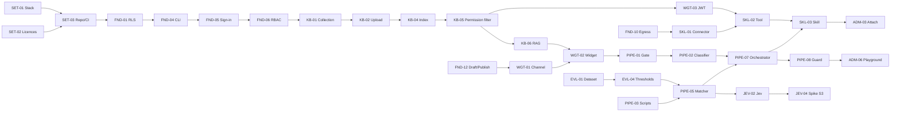

# ei-ai assistant — Prototype & MVP backlog (Jira EA)

- **Updated:** 2026-10-13
- **Sources:** [tong-hop.md](../workshop/tong-hop.md), [phan-bien-va-quyet-dinh.md](../workshop/phan-bien-va-quyet-dinh.md) (D1–D66), [jev-spike.md](../workshop/jev-spike.md), [design-decisions.md](../design/design-decisions.md)
- **Jira:** project `EA` — https://nguyenchiemhao2205.atlassian.net/jira/software/projects/EA/issues
- **Story details** (full template: User Story, Given/When/Then AC, Expected Result, **Design reference**, technical notes, NFR, tests, open questions + proposals, DoD) live in the Jira ticket descriptions, all written in English. This file is the summary.
- **Design:** canvas "ei-ai Prototype UI" (25 artboards) — https://claude.ai/artifact/4YiSppZaEbjh9C5YSMgHUF — hub ticket DSN-01 (EA-85).
- **Test environment:** nothing is deployed yet. The DoD of every story is "All AC pass in the local integration environment (SET-03)"; staging (SET-05) is deferred until the MVP is complete.
- **Maintained with** the project skills `jira-ticket-management` (tickets, sprints, review, status) and `git-commit` (ticket branches and commits) in `.claude/skills/`.

---

## 1. Idea analysis (summary)

**Idea:** an AI assistant embedded (iframe) into a company's existing web apps; it knows who the user is through a token signed by the customer's backend; it answers from group-permissioned documents, returns approved scripts verbatim, and reads live app data through Skills with identity bound to the token; local models by default with good Vietnamese; one multi-tenant codebase (hosted + self-hosted).

**Prototype goal (D61):** prove the D3 positioning with the fictional company Mekong Devworks on local models: correct answers from documents, verbatim scripts, and app data looked up for the right person.

**Actors:** Platform Operator · Org Owner/Admin · Workspace Admin · Developer · Builder · Knowledge Editor · Reviewer · Viewer · end users (signed-in / anonymous) · external systems (HR API, Jev, cloud BYOK).

**Main risks reflected in the backlog:** R1 tech stack (SET-01/02), R2/R8 unmeasured model quality (SET-04, E8), R4 tenant/identity leaks (FND-02, WGT-03, SKL-02), R5 no customer API (SKL-04 mock), R6 Jev early access (JEV-01 first, E5 kept separate), R7 legal (MVP-10), R3 large scope (see section 6).

## 2. Clarifying questions & defaults in use

The owner could not answer yet → **every question is attached to its ticket with a proposal** ("⚠️ Open questions"). The most important assumptions:

| # | Question | Default in use | Ticket |
|---|---|---|---|
| Q1 | Size of the "AI team", who reviews code? | 1 person (PO/Tech Lead) reviews + AI coding agent | SET-01 |
| Q2 | Tech stack? | Proposed Python/FastAPI + PostgreSQL RLS + pgvector + React/Preact + llama.cpp/vLLM behind an OpenAI-compatible API — decided by a spike | SET-01, SET-02 |
| Q3 | Prototype deadline? | None; roadmap of 10 × 2-week sprints | SET-01 |
| Q4 | Velocity? | **Assumed 40 SP per 2-week sprint** | section 5 |
| Q5 | Where is staging, what budget? | **Decided: deferred** — no deploy; test in the local environment (SET-03, WGT-10, SKL-04); set up staging and re-test once the MVP is complete | SET-05 (E9) |
| Q6 | Minimal "Talk to HR" in the prototype (V1)? | **Approved** — yes, priority Medium; MailHog locally | WGT-11 |
| Q7 | Does the Organization policy go through Draft/Publish? | Effective immediately (needs confirmation, differs from D20) | ADM-01, ADM-04 |
| Q8 | HS256 or RS256 for Channel tokens? | HS256 in the prototype, RS256 in the MVP | WGT-01 |
| Q9 | Jev API format, what is sent to Jev? | Title + 1 sample question per candidate, masked user question | JEV-02 |
| Q10 | Cost unit of local models for quotas? | GPU-seconds / tokens with an internal factor | MVP-03 |

## 3. Epics

| Epic | Jira | Milestone | Points |
|---|---|---|---|
| E0 Tech foundation, tech stack & UI design | EA-1 | before M0 | 19 |
| E1 Multi-tenant, security & observability foundations | EA-2 | M0 | 76 |
| E2 Knowledge Base & permission-aware RAG | EA-3 | M1 | 52 |
| E3 Widget & Channel | EA-4 | M2 | 62 |
| E4 5-step pipeline & Answer Scripts | EA-5 | M3 | 48 |
| E5 Jev Decision Provider | EA-6 | M3b | 19 |
| E6 Thin slice of Skills & Connectors | EA-7 | M4 | 27 |
| E7 Assistant configuration & operations | EA-8 | M5 | 49 |
| E8 Quality evaluation & test data | EA-9 | cross-cutting | 26 |
| **Prototype total (E0–E8)** | | | **378** |
| E9 MVP hardening (after the prototype, incl. SET-05 staging) | EA-10 | MVP | 55 |
| **Grand total** | | | **433** |

## 4. Story summary

Points are stored as `sp-N` labels (Story Points field not enabled in EA — see section 7).

| Code | Jira | Summary (short) | Pts | Priority | Blocked by |
|---|---|---|---|---|---|
| SET-01 | EA-11 | Spike: tech stack & architecture (ADR) | 5 | Highest | — |
| SET-02 | EA-12 | Spike: OSS libraries & licences | 3 | Highest | — |
| SET-03 | EA-13 | Repo skeleton, one-command local env, CI | 5 | Highest | SET-01, SET-02 |
| SET-04 | EA-14 | Spike: model-evaluation infra (rented GPU) | 3 | High | — |
| DSN-01 ⓟ | EA-85 | UI design: canvas, visual language, X1–X15 | 3 | High | — |
| FND-01 | EA-18 | Multi-tenant data model + RLS | 8 | Highest | SET-03 |
| FND-02 | EA-19 | Tenant-isolation tests in CI | 5 | Highest | FND-01 |
| FND-03 | EA-20 | Per-Org encryption keys, per-Org vectors | 8 | High | FND-01 |
| FND-04 | EA-21 | CLI to create Org/Workspace + demo seed | 5 | Highest | FND-01 |
| FND-05 | EA-22 | Admin sign-in + navigation shell | 8 | Highest | FND-04 |
| FND-06 | EA-23 | 3-tier RBAC + Members & roles | 8 | Highest | FND-05 |
| FND-07 | EA-24 | OpenAI-compatible Model Gateway, pinned versions | 8 | Highest | SET-03 |
| FND-08 | EA-25 | PII-masked logs + append-only audit | 5 | High | FND-01 |
| FND-09 | EA-26 | Version-stamped trace + usage metering | 8 | High | FND-01 |
| FND-10 | EA-27 | Egress proxy + allowlist | 5 | High | SET-03 |
| FND-11 | EA-28 | Vietnamese normalisation (NFC, tone marks, accent stripping) | 3 | Highest | SET-03 |
| FND-12 | EA-29 | Assistant Draft/Published | 5 | High | FND-01 |
| EVL-01 | EA-16 | Dataset: 40 scripts + 400 questions | 8 | Highest | — |
| EVL-02 | EA-30 | One-command platform evaluation suite | 8 | High | FND-07, EVL-03 |
| EVL-03 | EA-17 | Sample KB documents + RAG questions | 5 | High | — |
| EVL-04 | EA-31 | Spike: S1/S2/C1 + 3-band thresholds | 5 | High | EVL-01, SET-04 |
| KB-01 | EA-32 | Collections/Folders, 3 access levels, local-only | 5 | Highest | FND-06 |
| KB-02 | EA-33 | Upload & process PDF/DOCX/MD/TXT | 8 | Highest | KB-01, FND-03, FND-11 |
| KB-03 | EA-34 | XLSX/CSV row lookups | 5 | Medium | KB-02 |
| KB-04 | EA-35 | Hybrid index (accent-stripped keywords + vectors) | 8 | Highest | KB-02, FND-07 |
| KB-05 | EA-36 | Permission filter before the model + rerank | 8 | Highest | KB-04 |
| KB-06 | EA-37 | RAG with citations, strict mode, "Ask this collection" | 8 | Highest | KB-05, EVL-03 |
| KB-07 | EA-38 | Replace/delete documents with immediate effect | 5 | High | KB-04 |
| KB-08 | EA-39 | Glossary + query expansion | 5 | High | KB-05 |
| WGT-01 | EA-40 | Channel, allowed sites, signing keys, embed code | 8 | Highest | FND-12, FND-06 |
| WGT-02 | EA-41 | Iframe widget + streaming | 8 | Highest | WGT-01, KB-06 |
| WGT-03 | EA-42 | Host-signed JWT + group permissions | 8 | Highest | WGT-01, KB-05 |
| WGT-04 | EA-43 | Limited anonymous mode | 5 | High | WGT-02, WGT-03 |
| WGT-05 | EA-44 | Citations + safe output filter (XSS, external images) | 5 | Highest | WGT-02 |
| WGT-06 | EA-45 | 👍/👎 + bilingual greeting and suggestions | 5 | Medium | WGT-02 |
| WGT-07 | EA-46 | Channel appearance + live preview | 5 | Medium | WGT-02 |
| WGT-08 | EA-47 | Encrypted conversations, 90-day retention | 5 | High | WGT-02, FND-03 |
| WGT-09 | EA-48 | Mobile + maintenance/busy states | 5 | Medium | WGT-02 |
| WGT-10 ⓟ✔ | EA-49 | Local demo site (Employee Portal :4001, Careers :4002) + token-signing backend | 3 | High | WGT-01 |
| WGT-11 ⓟ✔ | EA-50 | "Talk to HR" email hand-off (V1; MailHog locally) | 5 | Medium | WGT-08, PIPE-03 |
| PIPE-01 | EA-51 | Pipeline frame + Gate | 8 | Highest | WGT-02, FND-08, FND-09, FND-11 |
| PIPE-02 | EA-52 | Local 7-class Classifier | 8 | High | PIPE-01, EVL-01 |
| PIPE-03 | EA-53 | Answer Scripts CRUD | 8 | High | FND-06 |
| PIPE-04 | EA-54 | CSV import of scripts | 3 | Medium | PIPE-03 |
| PIPE-05 | EA-55 | Local Script Matcher, 3 bands | 8 | Highest | PIPE-01, PIPE-03, EVL-04 |
| PIPE-06 | EA-56 | "Test match" in the editor | 3 | Medium | PIPE-05 |
| PIPE-07 | EA-57 | Orchestrator + context budget | 5 | High | PIPE-02, PIPE-05 |
| PIPE-08 | EA-58 | Response Guard | 5 | High | PIPE-07 |
| JEV-01 | EA-59 | Register for early access + review terms | 1 | Highest | — |
| JEV-02 | EA-60 | Jev Decision Provider + fallback | 8 | Medium | PIPE-05, JEV-01, FND-10 |
| JEV-03 | EA-61 | 2-level Jev switch + platform-wide switch | 5 | Medium | JEV-02, ADM-04 |
| JEV-04 | EA-62 | Spike: S3 + keep/drop decision | 5 | Medium | JEV-02, EVL-04 |
| SKL-04 ⓟ✔ | EA-63 | Local mock HR System API (leave balance + request log) | 3 | High | SET-03 |
| SKL-01 | EA-64 | HTTP Connector | 8 | High | FND-10, FND-06 |
| SKL-02 | EA-65 | Read-only Tools with token-bound identity | 8 | High | SKL-01, WGT-03, SKL-04 |
| SKL-03 | EA-66 | Fixed-flow Skill "Check my leave balance" | 8 | High | SKL-02, PIPE-07 |
| ADM-01 | EA-67 | 3-layer Instructions + Draft/Publish UI | 8 | High | FND-12, FND-06 |
| ADM-02 | EA-68 | Pinned model + cloud warning | 5 | High | ADM-01, FND-07 |
| ADM-03 | EA-69 | Attach Knowledge/Scripts/Skills + local-only conflict | 5 | High | ADM-01, KB-01, SKL-03 |
| ADM-04 | EA-70 | Org model providers, BYOK, Org policy | 8 | Medium | FND-07, FND-08, FND-06 |
| ADM-05 | EA-71 | Emergency switches | 5 | High | WGT-01, SKL-01, ADM-04 |
| ADM-06 | EA-72 | Playground + 5-step trace | 8 | High | PIPE-08, WGT-03 |
| ADM-07 | EA-73 | Conversations (Reviewer) | 5 | Medium | WGT-08, PIPE-08 |
| ADM-08 | EA-74 | Dashboard + unanswered questions | 5 | Medium | PIPE-08, WGT-06, WGT-08 |
| MVP-01 | EA-75 | 2FA (TOTP) | 5 | Low | FND-06 |
| MVP-02 | EA-76 | Audit log UI + CSV | 5 | Low | FND-08 |
| MVP-03 | EA-77 | Org quotas + per-Channel cost cap | 8 | Low | FND-09, WGT-04 |
| MVP-04 | EA-78 | Delete one end user's data | 5 | Low | WGT-08, FND-09 |
| MVP-05 | EA-79 | Tenant lifecycle | 8 | Low | FND-03, FND-04 |
| MVP-06 | EA-80 | Bilingual attack suite | 5 | Low | EVL-02, PIPE-08, SKL-03 |
| MVP-07 | EA-81 | Assistant rollback | 3 | Low | ADM-01 |
| MVP-08 | EA-82 | Org Theme + overrides + WCAG | 8 | Low | WGT-07 |
| MVP-09 | EA-83 | Spike: alerts & analytics | 3 | Low | ADM-08 |
| MVP-10 | EA-84 | Legal prerequisites before the first paying customer (O7) | — | Low | — |
| SET-05 ⓟ⏸ | EA-15 | Staging + automatic deploys — **deferred**, re-test the MVP | 5 | Low | SET-03 |

ⓟ = **[Proposed]** (not in the source docs; keep or drop at the owner's discretion). ✔ = approved by the owner (label `approved`). ⏸ = deferred (label `deferred`, moved to E9). EVL-02/EVL-03 and FND-02 are enablers the docs require indirectly (F3, F15).

## 5. Dependencies & roadmap

### 5.1 Critical path

### 5.2 Proposed sprint plan

Assumed **velocity 40 SP per 2-week sprint** (1 human reviewer + AI agent — recalibrate after the first 2 sprints).

| Sprint | Content | SP | Milestone |
|---|---|---|---|
| S1 | SET-01, SET-02, SET-04, JEV-01, SET-03, DSN-01, EVL-01, EVL-03, FND-11 | 36 | Stack decided; dataset; X1–X15 settled |
| S2 | FND-01, FND-02, FND-04, FND-07, FND-10, FND-12, SKL-04 | 39 | |
| S3 | FND-03, FND-05, FND-08, FND-09, EVL-02 | 37 | **M0** |
| S4 | FND-06, EVL-04, KB-01, KB-02, PIPE-03, WGT-01 | 42 | |
| S5 | KB-03, KB-04, KB-05, KB-07, PIPE-04, ADM-01 | 37 | |
| S6 | KB-06, KB-08, WGT-02, WGT-03, WGT-10, SKL-01 | 40 | **M1** |
| S7 | WGT-04, WGT-05, WGT-06, WGT-08, PIPE-01, ADM-02, ADM-04 | 41 | **M2** |
| S8 | PIPE-02, PIPE-05, PIPE-06, WGT-07, WGT-09, SKL-02 | 37 | |
| S9 | PIPE-07, PIPE-08, SKL-03, ADM-05, ADM-07, JEV-02* | 36 | **M3, M4** |
| S10 | ADM-03, ADM-06, ADM-08, JEV-03*, JEV-04*, WGT-11 | 33 | **M5**, M3b* |
| S11–12 | E9 MVP hardening (55 SP, incl. SET-05 staging + full MVP re-test) | 55 | MVP |

\* Only once a Jev key is available; otherwise postpone — it does not block M5.

**Estimate:** prototype ~10 sprints (~20 weeks) at 40 SP/sprint; MVP ~1.5 more sprints (excluding stories that come out of MVP-09 and MVP-10).

### 5.3 Options to shorten the prototype

Cut or move after M5 while keeping the three parts of the D3 positioning: KB-03 (5), PIPE-04 (3), PIPE-06 (3), WGT-07 (5), WGT-09 (5), ADM-04 (8 — cloud BYOK; the prototype runs local), E5 Jev (19) → **~48 SP saved (~1.2 sprints)**. WGT-11 is approved, so it is not on the cut list. Note D21: the owner wants to try Jev, so E5 is postponed, never dropped.

## 6. Self-check

- **No story ≥ 13.** Large stories are already split: Upload (KB-02 text / KB-03 tables — by data type); Answer Scripts (PIPE-03 authoring / PIPE-04 import / PIPE-06 test match — by interface); Skill (SKL-01 Connector / SKL-02 Tool / SKL-03 Skill — by layer, each demoable); Jev (JEV-01 register → JEV-02 integrate → JEV-04 measuring spike — spike kept separate because of high uncertainty); Assistant config (ADM-01/02/03 by tab).
- **Stories outside 5–8 points:** SET-02, SET-04 (3 — 1–2 day time-boxed spikes); DSN-01 (3 — screens already drawn, only discrepancies + tokens remain); FND-11 (3 — base library used in 3 places); WGT-10, SKL-04 (3 — independent demo enablers); PIPE-04, PIPE-06 (3 — split so PIPE-03/05 stay ≤ 8); JEV-01 (1 — admin task with a long wait); MVP-07, MVP-09 (3); MVP-10 (not estimated — legal work).
- **INVEST warnings:** E1 stories (FND-*) are **technical enablers** with indirect end-user value — accepted because they are foundations that "cannot be added later" (tong-hop §5). ADM-03 depends on SKL-03 (weak independence) — the Skill-attach part can be split off if ADM-03 is needed earlier. PIPE-01 refactors the existing widget flow → re-run EVL-02 to catch regressions.

## 7. Jira notes

- EA is team-managed; **the Story Points field is not enabled** → points are in `sp-N` labels and in the description. Enable "Story point estimate" in Project settings → Issue types, then backfill from the labels (JQL `labels = sp-8`…).
- There is no "Spike" issue type → spikes are **Tasks** + label `spike`.
- Other labels: `prototype` / `mvp`, `proposed`, `enabler`, `M0`…`M5`, module labels (`kb`, `widget`, `pipeline`, `jev`, `skill`, `admin-ui`, `security`…). Full list: `.claude/skills/jira-ticket-management/references/jira-conventions.md`.
- Links: 112 **Blocks** (transitive dependencies removed) + 52 **Relates** + 43 **Relates** from DSN-01 (EA-85) to every UI ticket. Each description also lists Blocked by / Blocks / Relates.
- Status labels: `approved` (WGT-10, WGT-11, SKL-04), `local-env` (WGT-10, SKL-04), `deferred` (SET-05).
- Sprint, Fix version, Assignee: not assigned yet. Sprints: real Jira sprints via the REST helper of `jira-ticket-management` (needs `JIRA_EMAIL`/`JIRA_API_TOKEN` and the Sprints feature); fallback is `sprint-N` labels + the table in section 5.2.

## 8. UI design ↔ backlog (DSN-01, EA-85)

Canvas: https://claude.ai/artifact/4YiSppZaEbjh9C5YSMgHUF. Every UI ticket has a **Design reference** section (artboard, labels, states to build). Discrepancies between the design and the decisions/tickets — the proposal on the right is used until the owner decides:

| # | Discrepancy | Proposal in use |
|---|---|---|
| X1 | CollectionDetail shows a .doc file (D61: DOC in the MVP) | Keep .doc out of the prototype, tag "Later" |
| X2 | Upload limit 50 MB vs 25 MB | 50 MB |
| X3 | Contrast check in ChannelAppearance (D16: MVP) | Read-only indicator in WGT-07; full check in MVP-08 |
| X4 | Unanswered grouped by similarity (V3: raw list) | Raw list, no Cause column (ADM-08) |
| X5 | Rate limit 20/min vs 10 | 20 signed-in / 10 anonymous, configurable |
| X6 | "Talk to HR" tagged Later | Remove "Later" (WGT-11 approved) |
| X7 | Variables `{name}` vs `{user.name}` | `{name}`, `{page}` |
| X8 | Answer length field | Keep (ADM-01) |
| X9 | Access level per script set | Same 3 levels as Collections (needs confirmation) |
| X10 | Version history (rollback = MVP) | Read-only list; rollback in MVP-07 |
| X11 | Connector timeout/size | 5/10 s, 64/256 KB; platform caps 10 s / 256 KB |
| X12 | `EiAI.setTokenProvider` vs `ei.identify` | Use the design's API |
| X13 | "local models take over" when external AI is stopped (contradicts D18) | Keep D18; fix the canvas wording (ADM-05) |
| X14 | "Search messages" box in Conversations | Simple substring search; full-text in the MVP (ADM-07) |
| X15 | Org policy not going through Draft/Publish | Effective immediately (needs confirmation, = Q7) |

**Artboards still to draw:** "Talk to HR" confirmation step (WGT-11, before it starts); 2FA (MVP-01), audit log (MVP-02), usage & quota (MVP-03), end-user data deletion (MVP-04), rollback (MVP-07), Org Theme (MVP-08) — before the MVP phase.
